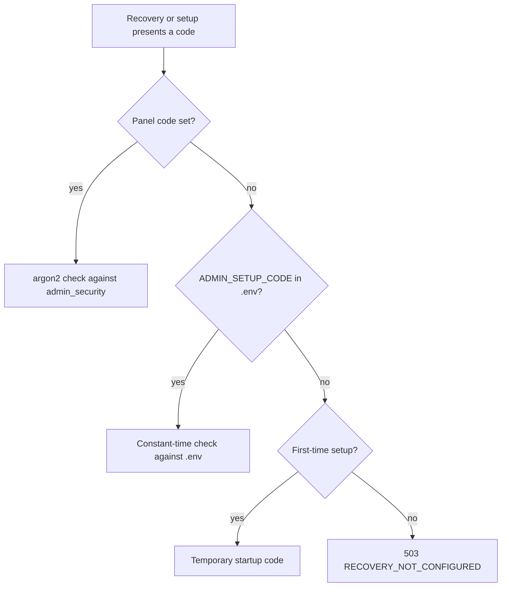
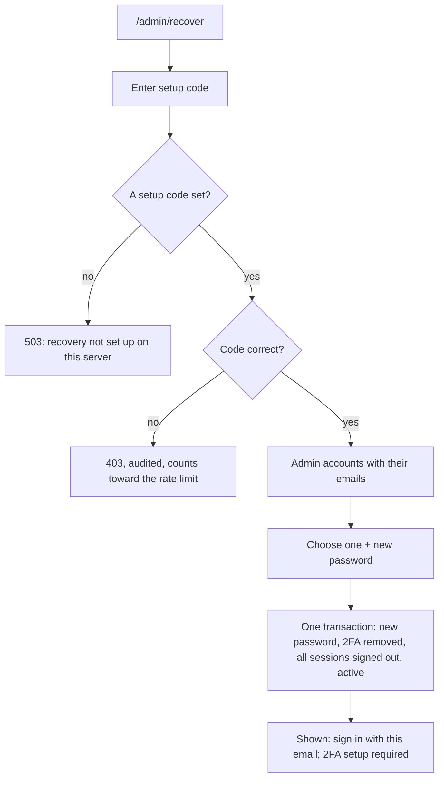

# Admin account guide

How to set up, use and recover the Healthmarg admin account. Sections 1–7 are step-by-step for the owner or server operator; section 8 is the technical reference for developers.

**You need:**
- access to the server's settings file, `backend/.env`;
- an authenticator app on your phone (Google Authenticator, Microsoft Authenticator, Authy or similar).

---

## 1. Before anything: set the setup code (once)

The **setup code** is a secret password for the server owner. It creates the first admin and recovers the admin account later.

1. Make a long random code (24 characters or more). For example, in a terminal:
   ```
   node -e "console.log(require('crypto').randomBytes(24).toString('base64url'))"
   ```
2. Open `backend/.env` and set:
   ```
   ADMIN_SETUP_CODE=<the code you made>
   ```
3. Restart the API, so it reads the new setting.
4. Store the code somewhere safe, such as a password manager. **Never share it, and never put it in Git.** Anyone with this code can take over the admin account.

> If `ADMIN_SETUP_CODE` is left empty, the API prints a temporary code in its startup log. That works only for creating the first admin, never for recovery. Set your own code.

> Once you are an admin, you can change the code **from the Admin panel** instead of editing this file (section 5). The `.env` code then becomes the emergency fallback.

---

## 2. Create the admin account (first time only)

1. Open **`/admin/setup`** on the website (for example `http://localhost:5173/admin/setup`).
2. Fill in:
   - **Setup code:** the code from step 1;
   - **Your name;**
   - **Admin email:** the email you will sign in with;
   - **Password:** at least 12 characters. A few unrelated words work well, e.g. `Banyan-shade-and-still-water`.
3. Click **Create admin account**, then **Go to admin sign-in**.
4. Sign in with that email and password.
5. **Set up two-step sign-in** (required for admins):
   1. Scan the QR code with your authenticator app.
   2. Type the 6-digit code it shows.
   3. **Save the 10 backup codes** that appear. Print them or keep them in your password manager. Each one signs you in once if your phone is lost.
6. You are now in the **Admin panel** at `/admin`.

After this, `/admin/setup` closes for good. Nobody can create another admin with it, not even with the setup code.

---

## 3. Signing in every day

1. Open **`/admin`**.
2. Enter your admin email and password, then **Continue**.
3. Enter the 6-digit code from your authenticator app. If your phone isn't with you, use one of your backup codes.

---

## 4. Recover the account

Use this if you **forgot the admin email**, **forgot the password**, or **lost the phone** with the authenticator app (and the backup codes).

1. Open **`/admin/recover`**. You can also click **"Can't sign in? Recover the admin account"** on the admin sign-in page.
2. Enter the **setup code** (the one set in Admin → Security, or the one in `backend/.env` if none was set there), then **Continue**.
3. The admin account is shown **with its email**. Note the email: that's your sign-in email.
4. Choose a **new password** (at least 12 characters), then click **Recover this account**.
5. The page confirms the email to sign in with. Click **Go to admin sign-in**.
6. Sign in with that email and the **new** password.
7. **Set up two-step sign-in again** (scan the new QR code, enter the code, save the new backup codes). The old authenticator entry and backup codes no longer work. Delete the old entry from the app.

**What recovery changes:**
- the password is replaced;
- two-step sign-in is reset (set up again at the next sign-in);
- **every device is signed out** of the admin account;
- a suspended admin account becomes active again;
- the recovery is recorded in the **Audit log**.

**What it never does:** create a new admin, change anyone's role, or touch member accounts.

---

## 5. Change the setup code from the Admin panel

You can change the setup code at any time, without editing files or restarting anything.

1. Sign in at **`/admin`** and open **Security** (सुरक्षा) in the admin menu.
2. The page shows:
   - **Code in use:** "Set here, in the Admin panel", or "ADMIN_SETUP_CODE from backend/.env (the fallback)";
   - when it was last changed, and by whom;
   - **wrong codes tried in the last 24 hours.** If this isn't 0 and it wasn't you, someone may be guessing: change the code.
3. Under **Change the setup code**, enter:
   - **your password;**
   - **the 6-digit code** from your authenticator app;
   - the **new setup code**, twice. Or click **Generate a strong code**, then **Copy the code**, and save it in your password manager straight away. It is shown only here.

   Rules: at least 24 characters, no spaces, and not your password.
4. Click **Change setup code**. **It works at once**: the old code (from the panel or from `.env`) stops working immediately.

**Good to know:**
- The code is stored **only in scrambled (hashed) form**. Nobody can read it back, not even you or the database. If you lose it, set a new one here while you're signed in, or use the `.env` code (below).
- **Use the .env code instead** removes the panel code, so `ADMIN_SETUP_CODE` from `backend/.env` counts again. This needs your password and a 2FA code too. It is refused if `.env` has no code, because then nobody could recover the account.
- **The emergency fallback:** if you lose the panel code *and* can't sign in, recovery needs the panel code, which only an admin can change. Keep the panel code in your password manager. If it's truly lost, a developer can clear it in the database (`UPDATE admin_security SET setup_code_hash = NULL`), and then `ADMIN_SETUP_CODE` from `.env` counts again.
- Every change is in the **Audit log**: `admin.setup_code.changed`, `admin.setup_code.removed`, and `admin.setup_code.change_failed` for a wrong password or 2FA code. The code itself is never logged.

---

## 6. If something goes wrong

| Message | What to do |
|---|---|
| **"Healthmarg's server didn't answer"** | The API isn't running, or it refuses this website. Start it (`npm run dev` in `backend`). On your computer, check that `CLIENT_ORIGIN` in `backend/.env` lists the exact address in your browser's address bar, for example `http://localhost:5173,http://localhost:5174`, then restart the API. |
| **"You're offline"** | Your device has no internet connection. Reconnect, then try again. |
| **"Recovery isn't set up on this server"** | No code is set (neither in the panel nor in `.env`). Do step 1, restart the API, try again. |
| **"Your password is not correct"** (Security page) | Enter your admin sign-in password. |
| **"The two-step sign-in code is not correct, or was already used"** | Wait for the next code in your app (each code works once), then try again. |
| **"Set ADMIN_SETUP_CODE in backend/.env first"** | You tried *Use the .env code instead*, but `.env` has no code. Set one there first (step 1). |
| **"The setup code is not correct"** | Use the code that's in use (see Security: panel or `.env`), with no extra spaces. After many wrong tries you are paused for a while. |
| **"Too many attempts…"** | Wait the time shown (up to 15 minutes), then try again. |
| **"Setup is already complete"** on `/admin/setup` | An admin already exists. Sign in at `/admin`, or use **recovery** (section 4). |
| **"Your password has N characters. Use at least 12."** (or other password advice) | Choose a longer password, avoiding your name and email. |
| The 6-digit code is refused | Check the phone's clock is set automatically, and use the newest code. Or use a backup code. |

---

## 7. Keeping it safe

- Keep the setup code **long, random and secret**. If it may have leaked, change it in **Admin → Security** (section 5). It applies at once. If someone could have used it, also recover the account straight away (section 4), which signs everyone else out.
- Use a password you use nowhere else.
- Keep the backup codes offline, separate from your phone.
- Check **Admin → Audit log** now and then. Every setup, sign-in and recovery is listed there.

---

## 8. Technical reference

For developers. The owner's decisions behind this design (2026-10-30): first admin only for now, a reusable setup code for an admin who forgets their ID, and a code that can be changed later.

### Where admins live

There is no separate admin table. An admin is a row in **`users`** (database `healthmarg`) with **`role = 'admin'`**, like members.

| Table | Holds |
|---|---|
| `users` | Email, name, password hash (argon2id), `role`, `status`, `token_version` |
| `admin_security` | One row: the setup code set from the Admin panel, hashed (argon2id) |
| `user_two_factor` | The admin's 2FA (TOTP) secret, encrypted |
| `two_factor_backup_codes` | Hashed backup codes |
| `refresh_tokens` | Signed-in sessions |
| `audit_logs` (database `healthmarg_audit`) | Every admin action, including setup and recovery |

### Which setup code counts

1. The code set in Admin → Security, when there is one.
2. Otherwise `ADMIN_SETUP_CODE` from `backend/.env` (the fallback).
3. Otherwise, for first-time setup only, the temporary code printed in the API's startup log. Recovery never accepts it.



### Registration

Once an admin exists, `/admin/setup` closes for good (`409 SETUP_CLOSED`). **There is no public admin sign-up**, and the setup code never creates another admin. The first sign-in forces 2FA setup.

### Recovery

Holding the setup code proves the server operator. A successful recovery runs in one transaction:
- the new password is saved;
- 2FA and backup codes are removed;
- every session is signed out (`token_version` + 1, refresh tokens revoked);
- the account is reactivated if it was suspended.



**Safety rules**
- The panel code is checked with argon2, the `.env` code in constant time.
- The credential rate limit applies: 30 attempts per 15 minutes per IP, shared with sign-in.
- Only admin accounts can be recovered; a member's ID gets `404`.
- Recovery never creates an admin and never changes anyone's role.

### Changing the setup code

- Needs a signed-in admin with 2FA, plus the password and a fresh 2FA code. The credential rate limit applies.
- Rules: 24–200 characters, no spaces, and not the admin's password.
- Stored hashed only, and applied at once with no restart.
- Removing the panel code falls back to `.env`, and is refused when `.env` has no code (`409 NO_FALLBACK`).
- The Security page's count of wrong codes covers setup and recovery over the last 24 hours.

### Audit log actions

| Action | When |
|---|---|
| `admin.setup.failure` | Wrong code at first-time setup |
| `admin.recovery.failure` | Wrong code at recovery |
| `admin.recovery.lookup` | Admin accounts listed with the code |
| `admin.recovery.completed` | An account was recovered |
| `admin.setup_code.changed` | The panel code was set or changed |
| `admin.setup_code.removed` | The panel code was removed |
| `admin.setup_code.change_failed` | Wrong password or 2FA code at change or removal |

The code itself is never logged.

### API

| Method and path | Who | Body → answer |
|---|---|---|
| `POST /admin/recover/lookup` | Setup code | `{ setupCode }` → `{ admins: [{ id, email, displayName }] }` |
| `POST /admin/recover` | Setup code | `{ setupCode, adminId, password }` → `{ email }` |
| `GET /admin/security` | Admin + 2FA | → `{ setupCode: { source: "panel" \| "env" \| "none", changedAt, changedBy }, failedCodeAttempts24h }` |
| `PUT /admin/security/setup-code` | Admin + 2FA | `{ password, totpCode, newCode }` → `{ setupCode }` |
| `DELETE /admin/security/setup-code` | Admin + 2FA | `{ password, totpCode }` → `{ setupCode }` |

**Errors:** `403 SETUP_CODE_INVALID` · `403 PASSWORD_INCORRECT` · `403 TOTP_INVALID` · `404 NOT_FOUND` (not an admin) · `400 VALIDATION_FAILED` · `409 NO_FALLBACK` · `429 RATE_LIMITED` · `503 RECOVERY_NOT_CONFIGURED`.
