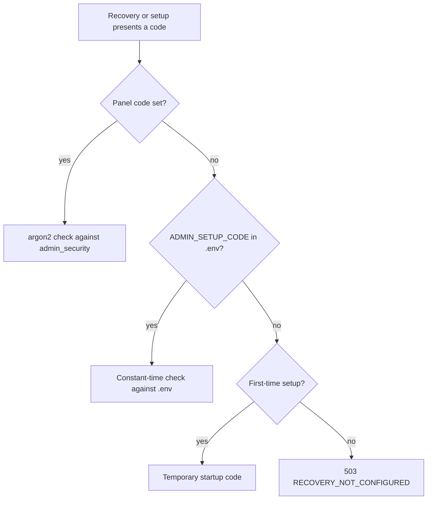

# Admin accounts: registration and recovery

Owner requests, 2026-10-30:
- "What is the name of the database table for admin?"
- "Set up a way so that admin can register himself."
- Decision: "First only admin for now, and also give reusable setup code for cases if admin forget his/her ID."

## Where admins live

There is no separate admin table. An admin is a row in **`users`** (database `healthmarg`) with **`role = 'admin'`**, like members. Related tables:

| Table | Holds |
|---|---|
| `users` | Email, name, password hash (argon2id), `role`, `status`, `token_version` |
| `user_two_factor` | The admin's 2FA (TOTP) secret, encrypted |
| `two_factor_backup_codes` | Hashed backup codes |
| `refresh_tokens` | Signed-in sessions |
| `audit_logs` (database `healthmarg_audit`) | Every admin action, including setup and recovery |

## Registration: first admin only (already built)

1. The server operator sets `ADMIN_SETUP_CODE` (at least 16 characters; 24+ recommended) in `backend/.env`. If it is blank, a one-time code is printed in the API's startup log.
2. Open **`/admin/setup`**, then enter the code, name, email and password.
3. The first sign-in forces 2FA setup (mandatory for admins).
4. Once an admin exists, `/admin/setup` closes for good (`409 SETUP_CLOSED`). **There is no public admin sign-up**, and the setup code never creates another admin.

## Recovery: reusable, with the setup code (new)

For an admin who forgot their login email or password, or lost their 2FA device. Whoever holds the server's `ADMIN_SETUP_CODE` is the server operator, so it proves the right to recover.

1. Open **`/admin/recover`** and enter the setup code. The admin accounts are listed with their **full email**, so a forgotten email is found again.
2. Choose the account and set a new password (the usual password rules apply).
3. In one transaction:
   - the new password is saved;
   - **2FA and backup codes are removed** (set up again at the next sign-in, which admins are forced to do);
   - **every session is signed out** (`token_version` + 1, refresh tokens revoked);
   - the account is reactivated if it was suspended.
4. The page shows the email to sign in with.

**Safety:**
- Recovery works **only when a setup code is set**: the Admin panel's (see below), or else `ADMIN_SETUP_CODE` (`503 RECOVERY_NOT_CONFIGURED` otherwise). The temporary startup code is never accepted for recovery.
- The code is compared in constant time.
- The credential rate limit applies: 30 attempts per 15 minutes per IP, shared with sign-in.
- Every attempt is audited: `admin.recovery.failure` (wrong code), `admin.recovery.lookup` and `admin.recovery.completed`.
- Only admin accounts can be recovered; a member's ID gets `404`.
- Recovery never creates an admin and never changes anyone's role.
- **Keep `ADMIN_SETUP_CODE` secret, long and random.** Anyone who has it can take over the admin account. Change it if it may have leaked.

```mermaid
flowchart TD
  A[/admin/recover] --> B[Enter setup code]
  B --> C{ADMIN_SETUP_CODE set?}
  C -- no --> X[503: recovery not set up on this server]
  C -- yes --> D{Code correct?}
  D -- no --> F[403, audited, counts toward the rate limit]
  D -- yes --> E[Admin accounts with their emails]
  E --> G[Choose one + new password]
  G --> H[One transaction: new password, 2FA removed, all sessions signed out, active]
  H --> I[Shown: sign in with this email; 2FA setup required]
```

## API

- `POST /admin/recover/lookup` `{ setupCode }` → `{ admins: [{ id, email, displayName }] }`
- `POST /admin/recover` `{ setupCode, adminId, password }` → `{ email }`

Errors: `403 SETUP_CODE_INVALID` · `404 NOT_FOUND` (not an admin) · `400 VALIDATION_FAILED` / password rules · `429 RATE_LIMITED` · `503 RECOVERY_NOT_CONFIGURED`.

## Changing the setup code from the Admin panel (Admin → Security)

Owner, 2026-10-30: "the ADMIN_SETUP_CODE should be like I can change in future", then "do it and update the docs also".

- **Admin → Security → Change setup code:**
  - needs **your password, a fresh 2FA code** and the new code twice;
  - or **Generate a strong code**, shown once with a copy button;
  - rules: 24–200 characters, and not your password.
- **Stored hashed only** (argon2id, like passwords), in table `admin_security` (one row). Nobody can read it back; a lost code is replaced, not recovered.
- **It applies at once** (no restart). The old code (panel or `.env`) stops working immediately.
- **Which code counts:** the panel code when one is set; otherwise `ADMIN_SETUP_CODE` from `backend/.env` (the fallback). First-time setup also accepts the temporary startup code, recovery never does.
- **Remove the panel code** (password + 2FA) falls back to `.env`. It is refused when `.env` has no code, because recovery would then be impossible (`409 NO_FALLBACK`).
- **The Security page shows:**
  - where the code comes from (panel / `.env` / none), when and by whom it was last changed;
  - how many wrong setup codes were tried in the last 24 hours (setup and recovery).
- **Audited:**
  - `admin.setup_code.changed` and `admin.setup_code.removed` (the code itself is never logged);
  - `admin.setup_code.change_failed` (wrong password or 2FA code).
- The credential rate limit applies to changes; the admin must be signed in with 2FA.



API (signed-in admin with 2FA):
- `GET /admin/security` → `{ setupCode: { source: "panel" | "env" | "none", changedAt, changedBy }, failedCodeAttempts24h }`
- `PUT /admin/security/setup-code` `{ password, totpCode, newCode }` → `{ setupCode: { source: "panel", changedAt, changedBy } }`
- `DELETE /admin/security/setup-code` `{ password, totpCode }` → `{ setupCode: { source: "env", … } }`

Errors: `403 PASSWORD_INCORRECT` / `403 TOTP_INVALID` (audited) · `400 VALIDATION_FAILED` · `409 NO_FALLBACK` · `429`.
