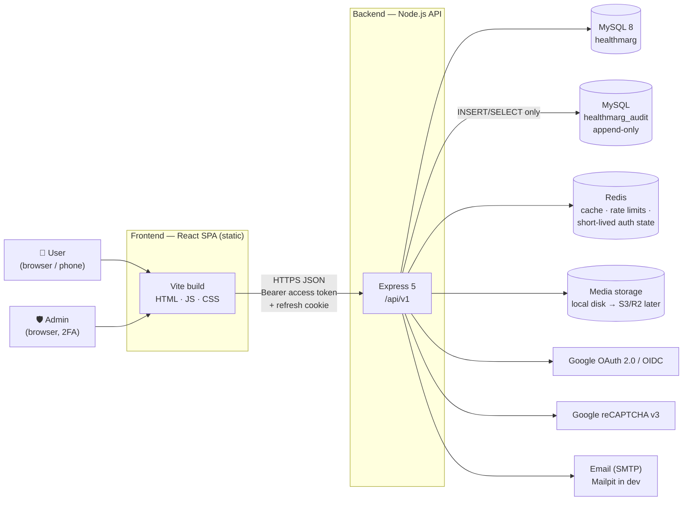
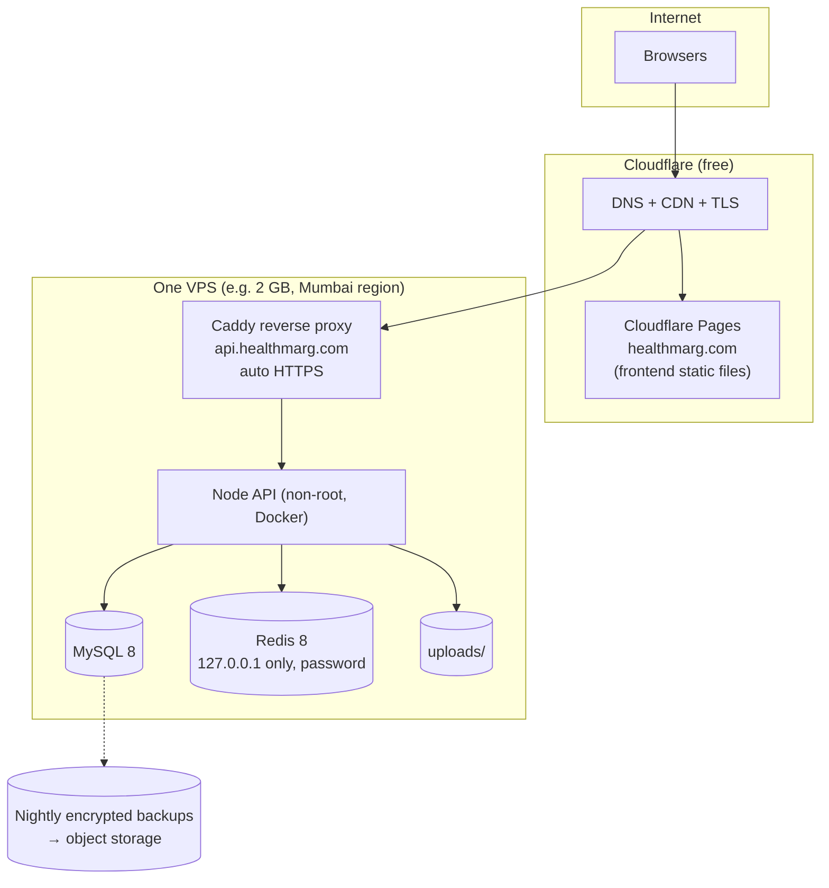
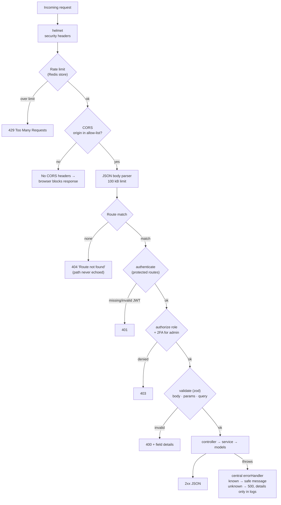
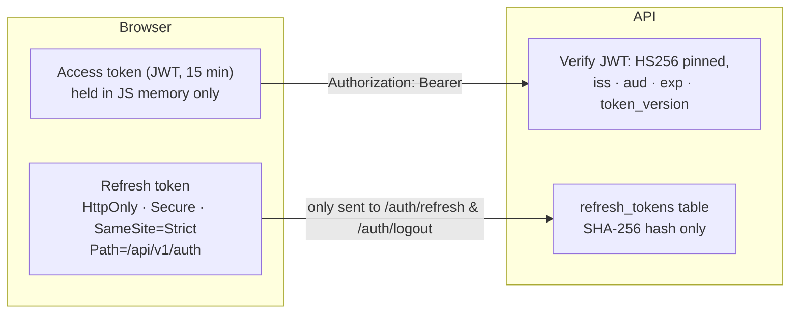
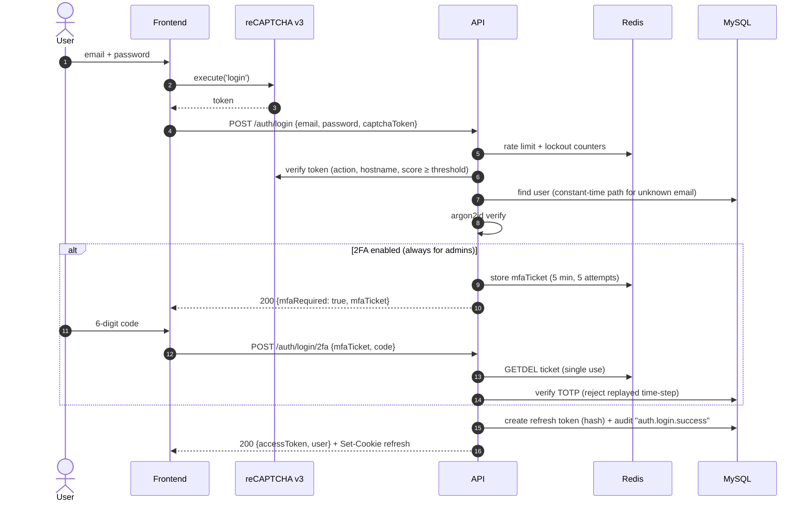
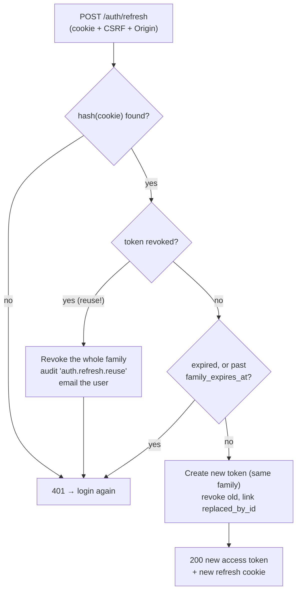
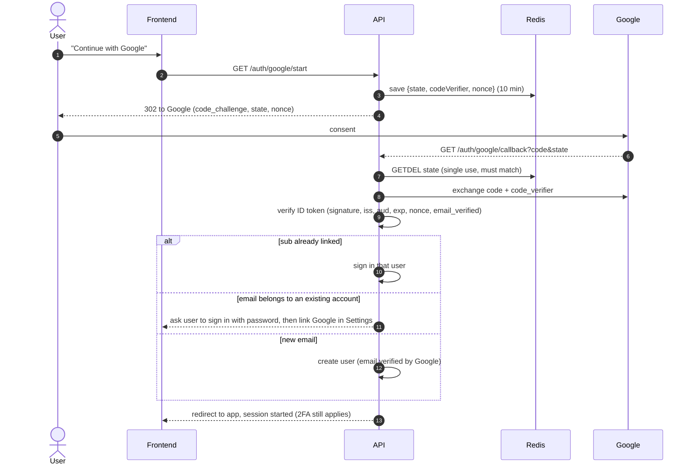
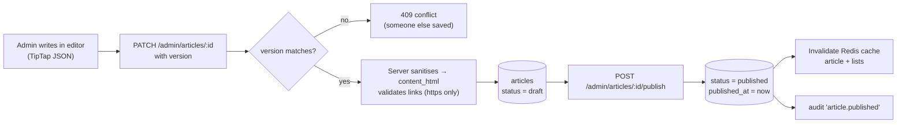
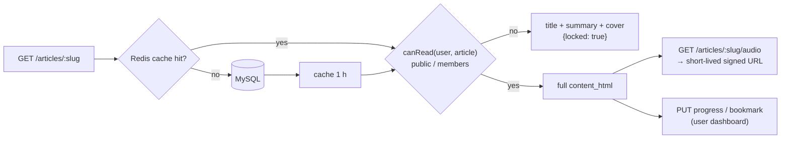
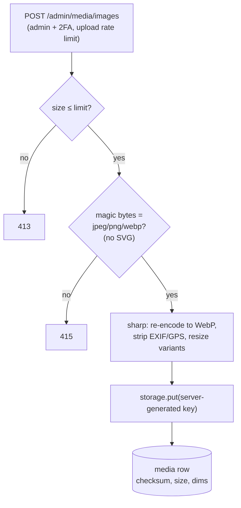

# Architecture & System Design

Healthmarg is a yoga and Ayurveda wellness web app. Signed-in users read and listen to articles about conditions (causes and Ayurvedic solutions). Admins write and design articles, upload media and manage users.

> **Scope now:** the `user` and `admin` roles and their dashboards.
> **Designed for, built later:** paid subscriptions, personal guidance from practitioners, and the AI assistant ("personal 24/7 guide"). See [plan.md](plan.md).

Diagrams use [Mermaid](https://mermaid.js.org). They render on GitHub and in VS Code with the "Markdown Preview Mermaid Support" extension.

---

## 1. Goals and constraints

| Goal | How the design meets it |
|---|---|
| **Secure by default** | Defence in depth: TLS, CORS allow-list, rate limits, reCAPTCHA v3, argon2id passwords, short JWTs with rotating refresh tokens, mandatory 2FA for admins, RBAC, input validation (zod), parameterised SQL (Sequelize), sanitised rich text, an append-only audit log, least-privilege DB users. |
| **Low running cost** | One small VPS runs the API, MySQL and Redis. The frontend is static files on a free CDN. No paid managed services are needed at launch. |
| **Separate frontend and backend** | Two independent apps (`frontend/`, `backend/`) with their own dependencies, tests and deploys. They share no code and talk only over HTTPS + JSON. |
| **Maintainable by a small team** | Strict TypeScript in the frontend, plain JavaScript (ESM) with zod-validated inputs in the backend, one module per feature, every change goes Developer → Reviewer → Tester → owner review ([workflow.md](workflow.md)). |
| **Room to grow** | Roles and access levels are extensible values. Content access goes through a single check that subscriptions can plug into later. Redis-backed state allows more than one API instance. |

---

## 2. System context



---

## 3. Components

### Frontend (`frontend/`)
- **Vite 8 + React 19 + react-router 8, in strict TypeScript 6** (`noUncheckedIndexedAccess`, `exactOptionalPropertyTypes`, type-aware ESLint). A single-page app built to static files; `npm run build` type-checks first.
- `services/apiClient.ts` is the **only** way the frontend reaches the backend: JSON, `credentials: 'include'`, typed errors. ESLint blocks importing backend code.
- `features/<feature>/` holds feature UI (auth, articles, audio, admin). `routes/` holds route guards (signed-in, admin).
- **Security:**
  - No secrets in the bundle. The build fails if a `VITE_*` variable name looks like a secret.
  - A `Content-Security-Policy` header is set by the static host.
  - Article HTML is rendered only through one sanitising component (DOMPurify). Raw `dangerouslySetInnerHTML` is banned by ESLint.

### Backend (`backend/`)
- **Node 24, Express 5, ESM.** Layering per feature module:
  ```
  routes  →  middlewares (auth, role, validate)  →  controller  →  service  →  Sequelize models
  ```
- `src/config/`: validated env (`env.js`), the MySQL/Sequelize connection (`db.js`), the Redis client (`redis.js`), constants.
- `src/db/`: models, migrations (Umzug), seeders, CLI.
- `src/middlewares/`: error handler, validation, rate limiting (and auth/RBAC next).
- `src/utils/`: logger (pino, redacts secrets), `ApiError`, Redis cache.

### Data stores
| Store | Holds | Notes |
|---|---|---|
| **MySQL 8** `healthmarg` | All permanent data: users, sessions, 2FA, content, reading progress | Source of truth. Accessed through Sequelize with the least-privilege `healthmarg_app` user. |
| **MySQL** `healthmarg_audit` | `audit_logs` | The app user can only `INSERT` and `SELECT`, so even a compromised app can't rewrite history. |
| **Redis** | Cache, rate-limit counters, short-lived auth state (2FA pending, OAuth state, token-version cache) | Every key has a TTL. Losing Redis never loses data. See [database.md](database.md#redis). |
| **Media storage** | Uploaded images and audio | Local disk in dev and at launch, S3-compatible (Cloudflare R2) later, behind one storage adapter. |

See [database.md](database.md) for the full schema and [api.md](api.md) for endpoints.

---

## 4. Deployment topology (production, low cost)



- **Same site, different origins.** The frontend runs on `healthmarg.com` and the API on `api.healthmarg.com`. Because they're the same site, the refresh cookie can be `SameSite=Strict` and still work. Testing logins on `*.pages.dev` would be cross-site and break cookies, so use the custom domain.
- MySQL and Redis listen only on localhost or the private network. Only Caddy is exposed (ports 80/443).
- Dev setup: MySQL as a Windows service, Redis in Docker (`backend/docker-compose.yml`), Vite on `:5173`, the API on `:5000`.

---

## 5. Request pipeline (backend)

Every request passes through the same ordered layers. Order matters: cheap rejections happen before expensive work.



> `authenticate`, `authorize` and reCAPTCHA arrive in the auth phase ([plan.md](plan.md)). Everything else is already built.

---

## 6. Security architecture

### 6.1 Layers (defence in depth)

| Layer | Control | Status |
|---|---|---|
| Transport | HTTPS only (Caddy/Cloudflare), HSTS | deploy phase |
| Edge | Rate limits per IP (Redis), stricter limits on auth routes, reCAPTCHA v3 on register/login/forgot-password | limits ✅, reCAPTCHA planned |
| Browser | CORS allow-list, helmet headers, CSP on the frontend host, `SameSite=Strict` refresh cookie, CSRF check on cookie routes | CORS/helmet ✅ |
| Identity | argon2id passwords, email verification, Google OAuth (PKCE + state + nonce), TOTP 2FA (mandatory for admins), account lockout | planned (auth phase) |
| Session | 15-min access JWT (in memory), rotating refresh token (hash only in DB) with reuse detection, `token_version` for instant revoke | schema ✅ |
| Authorisation | Role check per route (`user`, `admin`), ownership checks on per-user data, one central content-access check | planned |
| Input | zod validation on every input, `.strict()` objects, upload type sniffing + image re-encoding, server-side HTML sanitising | validate ✅ |
| Data | Sequelize parameterised queries, multi-statements disabled, least-privilege DB users, secrets hashed or encrypted (AES-256-GCM for 2FA) | ✅ |
| Detection | Append-only audit log, structured logs with secret redaction | schema + logger ✅ |
| Secrets | `.env` git-ignored and validated at startup, production refuses weak or missing secrets, no secrets in the frontend | ✅ ([security.md](security.md)) |

### 6.2 Token model



- **Why this split:** an XSS bug can't read an HttpOnly cookie. The in-memory access token dies with the tab. Only two endpoints accept the cookie, and they also require a CSRF token and a matching `Origin`.
- **Refresh rotation:** every refresh issues a new refresh token and revokes the old one. If an *old* token is ever presented again (stolen and replayed), the whole session family is revoked and the event is audited.
- **Instant revocation:** `users.token_version` is embedded in every JWT. Bumping it (logout everywhere, password change, role change, suspension) invalidates every access token within one request, using a cached Redis lookup.

### 6.3 Login with password, reCAPTCHA and 2FA



### 6.4 Refresh rotation and reuse detection



### 6.5 Google sign-in (OAuth 2.0 / OIDC with PKCE)



**Never auto-link** a Google identity to an existing password account by email alone. That prevents account takeover through a compromised or recycled Google account.

---

## 7. Key product flows

### 7.1 Article publishing (admin)



### 7.2 Reading and listening (user)



### 7.3 Media upload (admin)



---

## 8. Caching strategy

| What | Key (prefix `hm:`) | TTL | Invalidated when |
|---|---|---|---|
| Published condition list | `cache:conditions:list` | 1 h | A condition is created, edited or deleted |
| Published article | `cache:article:{slug}` | 1 h | That article is saved, published or unpublished |
| Article list pages | `cache:articles:list:{hash}` | 5 min | Any article is published or unpublished (prefix delete) |

- **Read-through:** `cache.getOrSet(key, ttl, loader)` in `src/utils/cache.js`.
- **Access is checked after the cache.** The cache stores the article; `canRead()` decides what each user sees, so cached content never leaks to the wrong user.
- **Fails open:** if Redis is down, the loader result is served straight from MySQL.

---

## 9. Failure handling

| Failure | Behaviour |
|---|---|
| MySQL down at startup | The API refuses to start (exit 1), so the process manager restarts it. |
| MySQL down at runtime | Requests fail with a 500 and a safe message. `/health` returns 503. |
| Redis down at startup | The API refuses to start. |
| Redis down at runtime | Commands fail immediately (`disableOfflineQueue`): no hanging requests. The cache falls back to MySQL. The general rate limit fails **open** (site stays up). The auth rate limit fails **closed** (login is refused rather than unthrottled). Auth state (2FA tickets, OAuth state) is unavailable, so those steps return 503. `/health` returns 503. |
| Unhandled error | Full details go to the logs only. The client gets `500 Internal server error`. |
| Unhandled promise rejection / exception | Logged as fatal, then the process exits for a clean restart. |
| SIGTERM / Ctrl+C | Graceful shutdown: stop accepting requests, finish in-flight ones, close MySQL and Redis, force-exit after 10 s. |

---

## 10. Scaling path (when needed, not before)

1. **Now:** one API process on one VPS, with MySQL and Redis on the same box.
2. **More traffic:** run 2+ API processes behind Caddy. This already works, because rate limits, auth state and the cache live in Redis, not in process memory.
3. **More data:** move MySQL to a managed instance and add read replicas for article reads. Media moves to R2 behind a CDN.
4. **Heavy features later** (AI assistant, audio processing): separate worker processes driven by a Redis job queue, so the API stays fast.

---

## 11. Technology decisions

| Area | Choice | Why |
|---|---|---|
| Backend runtime | Node 24, Express 5, ESM, plain JS | Lightweight, the team knows it, async error handling built in |
| ORM | **Sequelize 6.37** + **Umzug 3** migrations | Mature and stable with MySQL; v7 is still alpha. Umzug is ESM-native. |
| Primary keys | UUID v7 (`CHAR(36)`) | Not guessable or enumerable; time-ordered, so indexes stay efficient |
| Cache / state | **Redis 8** with the official `redis` client (node-redis 6) | Fast, cheap; `rate-limit-redis` integration |
| Validation | zod 4 | One schema system for env, requests and (later) frontend forms |
| Logging | pino | Fast, structured, built-in redaction |
| Passwords | argon2id (planned) | OWASP recommendation, memory-hard |
| JWT | `jose` (planned) | ESM, explicit algorithm pinning |
| Google sign-in | `openid-client` (planned) | Certified OIDC; handles PKCE, state, nonce and ID-token checks |
| 2FA | `otpauth` + `qrcode` (planned) | ESM, no dependencies, maintained |
| Frontend | Vite 8, React 19, react-router 8, TypeScript 6 | Fast builds, small bundle, data loaders without extra libraries; types catch API-shape and null mistakes before they ship |
| Tests | Vitest 5, supertest, Testing Library | One runner for both apps |
