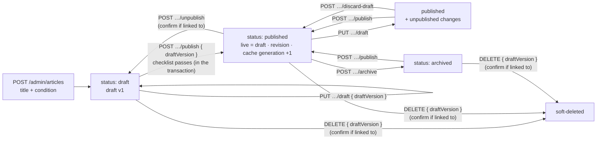
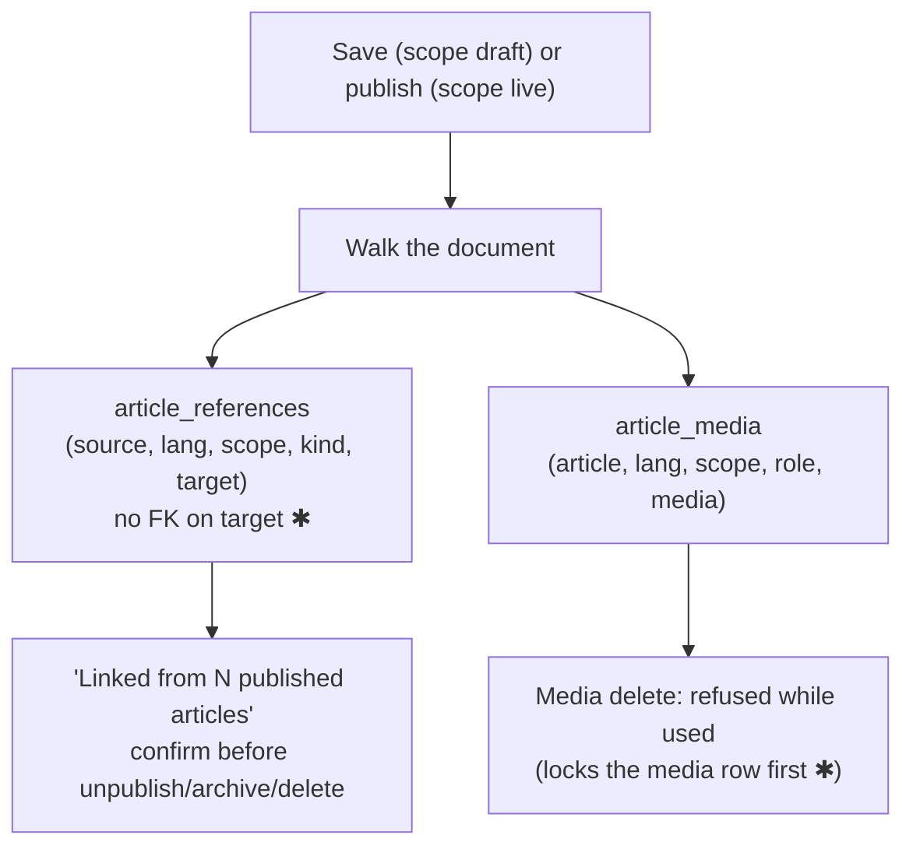

# Articles API (branch 3: `feature/articles-api`)

Branch 3 of the content phase ([content.md](content.md) §9). It builds the server side of writing and publishing:
- drafts with autosave;
- the publish checklist;
- revisions;
- references between articles;
- the public article API with caching.

The editor and reader pages (branch 4) speak exactly the document format defined here. **Launch scope (owner, 2026-10-27):** branches 3 and 4 make the launch. Speech, translations and audio/video follow as updates, so the tables below are already keyed for them.

**Not in this branch:**
- the editor UI and reader page (branch 4);
- speech (5);
- translations (6);
- audio/video blocks (7);
- bookmarks and reading progress.

The plan was reviewed before building. One reviewer (data integrity) reported 16 findings; 15 changed this plan, marked ✱. The other three reviewers failed on a network outage, and the code review at the end of the branch covers their angles.

---

## 1. Draft and live

Every article has two copies:
- **Draft** (table `article_drafts`): what the admin edits. Saved by autosave and **never shown to readers**.
- **Live** (the `articles` row): what readers see. It **changes only on Publish**, along with the live-only `title`, `summary`, `content_text` and full-text index ✱.



**Versions and saving:**
- **Its own version ✱.** The draft has its own `draft_version`, bumped only by draft saves, publish, discard and restore. Changing the status never makes an autosave fail.
- **Saves are atomic.** `UPDATE article_drafts … WHERE article_id = ? AND draft_version = ?`. A stale version gets `409 STALE_VERSION` with who saved last and when.
- **Identical autosaves are free ✱.** If the canonical hash equals the stored one, nothing is written and the same version comes back.
- **Publishing what was previewed.** Publish takes the `draftVersion` the admin saw, so it can never publish something else.
- **Deleted articles.** A save or publish against a deleted article gets `410 ARTICLE_DELETED`, so the editor can keep its local copy ✱.

**Hashes ✱:** one canonical serializer (sorted keys) over the validated draft. Publish copies the draft hash to `live_hash`, and "unpublished changes" means `draft_hash ≠ live_hash`.

**Revisions:**
- `publish`: every publish, all kept.
- `autosnap`: at most one per 10 minutes while editing; the newest 30 are kept.
- `restore`: the draft just before a restore; the newest 30.
- `manual`: on request; the newest 50.
- `delete`: on delete.

A snapshot identical to the newest one isn't stored again, and the revision list never loads the snapshots themselves ✱.

## 2. The draft (what the editor sends)

```jsonc
{
  "title": "Calming migraine with breath",       // 3–200
  "slug": "calming-migraine-with-breath",        // optional; made from the title when publishing if empty
  "summary": "…",                                 // the short description: ≤ 500 to save, 40–300 to publish
  "conditionId": "<uuid>",
  "accessLevel": "members",                       // public | members
  "lang": "en",                                   // en | hi: the article's original language
  "accent": "saffron",                            // saffron | teal | lotus | gold
  "cover": { "mediaId": "<uuid>|null", "alt": "…", "focalX": 50, "focalY": 40 },
  "relatedIds": ["<uuid>"],                       // up to 6 other articles, not itself
  "seoTitle": "…", "seoDescription": "…",         // optional, ≤ 70 / ≤ 160
  "body": { "type": "doc", "content": [ … ] }
}
```

**The body** is TipTap/ProseMirror JSON checked against an allow-list (`backend/src/modules/articles/document.js`, 42 hostile tests):

| Kind | Allowed |
|---|---|
| Blocks | paragraph; heading 2/3; bullet and ordered lists; quote; callout (note / tip / caution / doctor); Sanskrit verse; divider (line / lotus / danda); image (`mediaId`, `alt`, `caption`, size normal / wide / full); "Also read" card (`articleId`); line break |
| Styles | bold, italic, link (https/mailto only), article link (`articleId`) |
| Limits | depth 20, 10 000 nodes, 200 000 characters |

There is no HTML anywhere.

**Request size:** draft saves may be up to 1 MB. Every other route stays at 100 kB.
- The global parser skips the draft route.
- The 1 MB parser runs only *after* authenticate → admin → 2FA ✱, so an anonymous 1 MB request is never read.

## 3. Publish checklist

Run inside the publish transaction, on rows locked `FOR SHARE` ✱:
- the condition;
- the cover;
- every image.

So nothing can change between the check and the publish. `GET …/checklist` runs the same checks for the editor.

| Check | Blocks publishing? |
|---|---|
| Title 3–200; summary **40–300** | yes |
| Slug valid, and not used by another article or as another article's old address | yes |
| The condition exists and is published ✱ | yes |
| A thumbnail: an existing, ready image, with alt text (its own or the library's) | yes |
| A body of at least 50 words | yes |
| Every image block points at an existing, ready image and has alt text | yes |
| Article links, cards and related entries pointing at articles that aren't published (they'll show as plain text or be hidden) | warning |
| Another draft wants the same slug | warning |

**Conditions ✱:** a condition can't be unpublished while published articles are filed under it (`409 CONDITION_HAS_PUBLISHED_ARTICLES`).

## 4. References and media usage



- **No foreign key on targets ✱.** A target doesn't need a foreign key: articles are only soft-deleted, so it would never fire, and it would only add locks. Targets are resolved when the page is read, so a draft linking to a deleted article still saves; it shows as a warning.
- **Media deletion is serialised ✱.** Deleting media takes the media row `FOR UPDATE`, then counts usage. Inserting an `article_media` row needs that same row, so the two can't interleave. Publish then re-checks every image inside its transaction.
- **Readers never learn about unpublished articles.** When the live payload is built, links to them become plain text, and cards and related entries are dropped. Their ids are never sent.

## 5. Endpoints

**Admin** (authenticate → admin → 2FA; every write is audited; autosaves are audited at most once per 10 minutes per article):

| Method | Path | Purpose |
|---|---|---|
| GET | `/admin/articles?status=&conditionId=&q=&page=&pageSize=` | Draft title, status, "unpublished changes", condition, updated time. `q` searches draft titles (indexed) |
| POST | `/admin/articles` | `{ title, conditionId, accessLevel?, lang? }` → `201 { article }` |
| GET | `/admin/articles/:id` | `{ article }`: the draft, `draftVersion`, the live copy (if any), outbound references with each target's state, the inbound count, the checklist |
| PUT | `/admin/articles/:id/draft` | `{ draftVersion, draft }` → `{ draftVersion, savedAt, hasUnpublishedChanges }`. `409 STALE_VERSION`, `410 ARTICLE_DELETED`; 600 per 15 min per admin |
| GET | `/admin/articles/:id/checklist` | `{ ready, problems: [{ field, message, blocking }] }` |
| GET | `/admin/articles/:id/preview` | The draft, built exactly like the reader payload |
| POST | `/admin/articles/:id/publish` | `{ draftVersion }`. `422 PUBLISH_CHECKLIST` with every problem |
| POST | `/admin/articles/:id/unpublish` · `/archive` | `{ confirm? }`. `409 HAS_INBOUND_LINKS { count }` while published articles link here, unless `confirm: true` |
| POST | `/admin/articles/:id/discard-draft` | `{ draftVersion }`: the draft goes back to the live copy |
| DELETE | `/admin/articles/:id` | `{ draftVersion, confirm? }`: soft delete (same inbound rule) |
| GET | `/admin/articles/:id/revisions` · `/revisions/:revisionId` | The list (no snapshots) / one snapshot |
| POST | `/admin/articles/:id/revisions` | Save a manual revision of the draft |
| POST | `/admin/articles/:id/revisions/:revisionId/restore` | `{ draftVersion }`: the snapshot becomes the draft (the current draft is kept first) |

**Public:**

| Method | Path | Purpose |
|---|---|---|
| GET | `/articles?condition=&q=&cursor=&limit=` | Published cards, newest first. The cursor is `(published_at, id)` ✱, the limit at most 30, and search covers title, summary and text. `Cache-Control: public, max-age=60` |
| GET | `/articles/:slug` | A public article to anyone. A members article in full only when signed in: an invalid token is a `401` so the site refreshes, and anonymous visitors get a teaser with `locked: true, reason: SIGN_IN_REQUIRED`. An old slug answers `{ redirect: "<new slug>" }`. Members articles are `private, no-store` with `Vary: Authorization` |

**Caching ✱.**
- **Keys:** Redis keys include a global `articles` generation, which every publish, unpublish, archive, delete and condition change bumps *after* the transaction commits. A stale entry is then never read again.
- **What is cached:** the live payload (per article and version, 1 h) and the list pages (5 min).
- **The slug lookup** is a small indexed query on every request, so an unpublished article stops being served at once even if Redis is down.
- **Locally,** with no Redis, there is simply no cache.

## 6. Database (migration `20261027000100-articles-drafts`)

| Table | Change |
|---|---|
| `articles` | `slug` becomes nullable (set when first published), with a CHECK that published and archived articles have one. |
| | Adds `lang`, `card_accent`, `cover_alt`, `cover_focal_x/y` (0–100), `related_ids`, `content_text`, `live_hash`, `live_version`, `content_updated_at`. |
| | Drops `content_html`. |
| | Full-text index on `title, summary, content_text`; index on `(status, published_at, id)`. |
| | Existing rows are backfilled ✱. |
| `article_drafts` ✱ | `article_id` (PK), `draft_version`, `draft_json`, `draft_hash`, `draft_title` (indexed, for admin search), `updated_by_id`, timestamps |
| `article_references` | PK `(source_article_id, lang, scope, kind, target_article_id)`, index on the target. FK on the source only |
| `article_media` | PK `(article_id, lang, scope, role, media_id)`, index on the media. Both FKs RESTRICT |
| `article_revisions` | `id`, `article_id`, `reason`, `snapshot`, `snapshot_hash`, `size_bytes`, `created_by_id`, `created_at` |
| `article_slug_redirects` | `slug` (PK) → `article_id`: old addresses keep working |

All new foreign keys are `ON UPDATE RESTRICT ON DELETE RESTRICT`, except "who did it" columns (`SET NULL`). CHECKs are only on non-key columns (MySQL error 3823) ✱.

## 7. Tests

- **Attack:**
  - hostile documents;
  - the 1 MB route without auth;
  - drafts never public;
  - members content to anonymous visitors;
  - unpublished targets never leaking;
  - cache poisoning across sign-in states.
- **Data:**
  - stale saves;
  - two tabs;
  - publish racing media delete;
  - slug collisions and redirects;
  - revision caps;
  - migration up → down → up on existing rows.
- **Load:** the public article and list.
