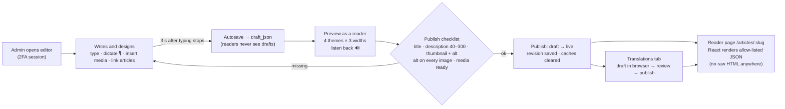
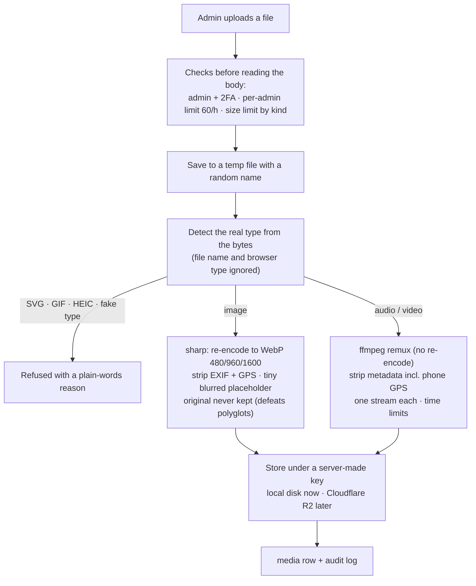
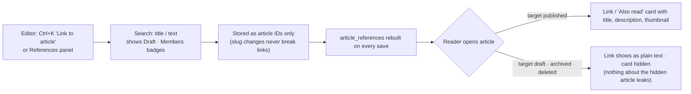
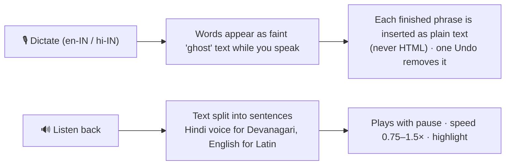
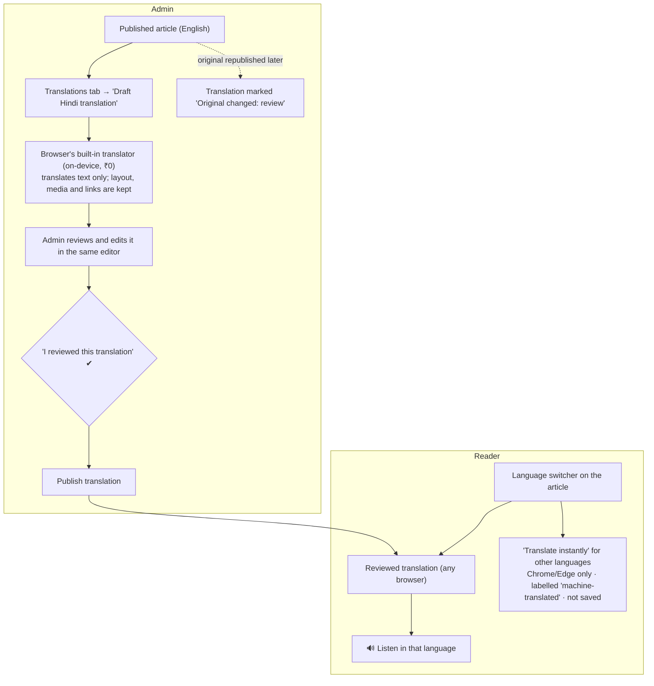
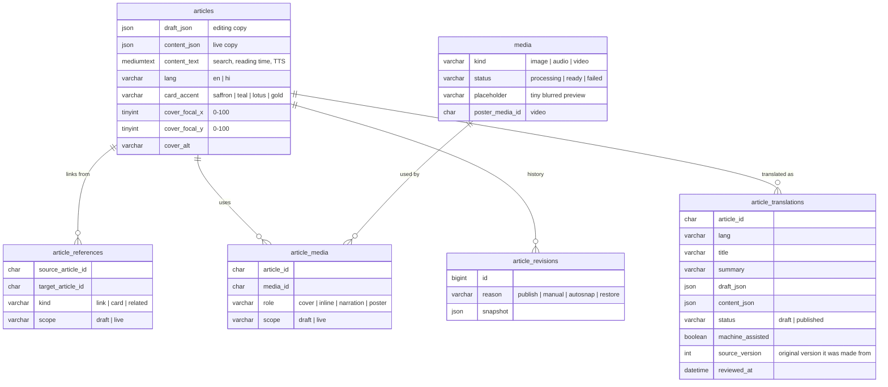

# Content: writing, designing and publishing articles

Owner request (2026-10-26):
- **Admins** write, design and publish articles with speech-to-text and text-to-speech.
- **Articles** can reference other articles, contain images, audio and video, and each has a title, a short description and a thumbnail designed by the admin.
- **Translation** is available for both admins and readers. The owner chose **free** translation.

This plan came from a design panel: three independent designs (security-first, editor-experience-first, cost-and-performance-first). A judge scored them 8 / 7 / 6.5 and merged them, checking the claims against the real code and npm. Translation was added afterwards, following the owner's decision.

---

## 1. How an article moves from idea to reader

- **Draft and live are separate.** Editing a published article saves into a draft. Readers keep seeing the live version until "Publish changes".
- **Nothing is lost.** Autosave runs 3 s after typing stops, with a crash copy in the browser, a warning when the same article is open in two tabs, and a "someone else saved" dialog instead of silently overwriting.
- **Revisions** are kept on every publish (and every 10 minutes while editing), and can be restored into the draft.

## 2. Designing an article

Body blocks: paragraphs (**bold**, *italic*, links), headings (H2/H3), lists, quotes, and callouts (note / tip / caution / "consult a doctor"). Also:
- a **Sanskrit verse** block (Devanagari, transliteration, meaning, source)
- **dividers** (line, lotus, ॥)
- **images** (normal / wide / full width, alt text required, caption)
- **audio** (with optional transcript) and **video** (with poster image)
- **"Also read" article cards** and **links to other articles**

The **card and thumbnail panel** (outside the body) holds:
- the title, the **short description** (40–300 characters, needed to publish) and the slug
- the condition, the language and who can read it (members / everyone)
- the **thumbnail**: an uploaded image, alt text, a **focal point** chosen by clicking (so it crops well everywhere) and an accent colour (saffron / teal / lotus / gold)
- related articles (up to 6) and the narration audio

Design controls are **theme presets only**: no free colour pickers, fonts or text over images. That way every article stays readable in all four themes, and the contrast test covers it.

## 3. Uploading images, audio and video

| Kind | Accepted | Limit | Readers get |
|---|---|---|---|
| Image | JPEG, PNG, WebP | 15 MB, ≤ 10,000 px per side | Public random URLs, cached forever |
| Audio | MP3, M4A/AAC, OGG, WebM/Opus (incl. recorded in-app) | 60 MB, 90 min | Signed links that expire, with seeking (HTTP Range) |
| Video | MP4 (H.264/AAC), WebM (VP9/Opus) | 150 MB, 10 min, 1080p | Signed links that expire, `preload="none"`, poster first |

- **Server load:** one file is processed at a time. If 3 are already waiting, an upload gets "busy, try again" (503 + Retry-After). Uploads are refused when the disk has under 2 GB free.
- **Deleting media:** media that's still used in an article can't be deleted (409 "used by N articles"). Covers and condition images are checked now; use inside article bodies is added with the articles API (branch 3).
- **Built in branch 2 (images):** a declared size over the limit is refused from the headers alone (413) and the connection is closed, so the body is never read. Files are parsed by multer into `UPLOAD_DIR/tmp` with random names (1 file, at most 2 parts, 2 KB of text) and the temp file is always deleted. The same file uploaded twice returns the first copy (SHA-256). Uploads must declare their size (411 otherwise), the server waits long enough for the largest image over a 1 Mbit/s uplink (150 s for 15 MB; headers are still cut at 15 s), each processing step has a 30 s limit, and leftover temp files from a crash are swept at startup and hourly. The same file uploaded twice at once is still stored once (the duplicate check runs again inside the one-at-a-time queue). The public image route answers from a small in-memory lookup cache (1000 images, 60 s, simultaneous misses share one query) and is limited separately from the rest of the API (1500 requests per 15 min per IP), because one page loads several images and browsers then keep them for a year. Downloads are streamed with `pipeline`, so a visitor who leaves mid-download never leaves a file open, and a miss is never cached. **Known trade-off:** browsers that already showed an image may keep it for up to a year after it is deleted (URLs are unguessable); when a CDN is added, deleting must also purge it there.

## 4. References between articles

- **Three kinds:** inline links, "Also read" cards and a related list (up to 6).
- **Admin panel:** shows "this article links to…" with each target's state, and "linked from N articles".
- **Unpublishing or deleting an article** that others link to asks for confirmation first ("3 published articles link here; those links will become plain text").

## 5. Speech: dictation and listening (free, in the browser)

- **Dictation** uses the browser's speech service, so it works in Chrome and Edge. Elsewhere the button is hidden and a hint suggests Windows dictation (Win + H).
  - Spoken punctuation works ("comma", "full stop", "new paragraph", and in Hindi "पूर्ण विराम" → ।).
  - The microphone stops when the tab is hidden or you leave the page.
  - **Privacy:** Chrome and Edge send the audio to Google or Microsoft to transcribe it. A one-time notice says so, along with "don't dictate patient details". On-device recognition is used where the browser offers it.
- **Listening** uses the device's voices, which are free. Admins can also record a human narration in the editor (teleprompter mode), and readers hear that when it exists.

## 6. Translation (free, in the browser)

- **No unreviewed translations go live.** For health advice, a machine translation can change a dose or a warning, so an admin must mark a translation reviewed before it can be published.
- **Each language** has its own title, description, text and slug-safe URL (`/articles/:slug?lang=hi`). Images, audio and video are shared. Links point to the target article in the reader's language when that translation exists.
- **Free:** the browser's built-in Translator API runs on the device, so the text never leaves the computer and there's no cost or key. It works in recent desktop Chrome and Edge. A **provider switch** lets a paid or self-hosted service be added later without changing anything else.
- **Languages at launch:** English and Hindi. More are added by extending one list.

## 7. Security in short

- **No raw HTML anywhere.** The API only accepts editor JSON, validated against an allow-list of node types and attributes, with limits on size (1 MB), depth, node count and link schemes (https/mailto only). Readers' pages are built by React from that JSON, and `dangerouslySetInnerHTML` stays banned.
- **Uploads:** the real type is sniffed, then the file is re-encoded or remuxed (removing hidden data and GPS), stored under random keys, never executed and served with sandbox headers.
- **Members-only audio and video** use short-lived signed links, minted only after checking the reader may read that article.
- **Every admin write is audited.** Autosaves are throttled and limited per admin.
- **Admins only, with 2FA:** every content route uses `authenticate → admin role → 2FA`.

## 8. Database changes

The link tables use **RESTRICT** foreign keys. Articles and media are soft-deleted, and MySQL 8 refuses CHECK constraints on columns with CASCADE or SET NULL actions (error 3823). This is a trap the design panel caught.

## 9. Build order (one branch each: Developer → Reviewer → Tester → Feedback → owner review)

| # | Branch | Delivers | Done when |
|---|---|---|---|
| 1 | `feature/conditions` | Conditions (what each article is about): admin create/edit/delete, public list, admin page | Real-DB, attack and load tests; Postman |
| 2 | `feature/media-images` ✅ built | Image upload pipeline (sharp → WebP, EXIF/GPS stripped), media library page | Attack suite: SVG, polyglots, pixel bombs, spoofed types, GPS photo comes out clean |
| 3 | `feature/articles-api` ✅ built | Article drafts, autosave, publish checklist, revisions, references, public article API with caching | Real-DB + attack tests (hostile JSON, links, 1 MB limit, draft never public); load test |
| 4 | `feature/article-editor` | The editor (TipTap 3), all blocks, thumbnail designer, references panel, preview, reader page | Contract test (editor ⇄ API schema), contrast test for new tones, bundle budgets, end-to-end publish |
| 5 | `feature/editor-speech` | Dictation + listen back in the editor | Mocked speech tests; Chrome/Edge manual check; Firefox fallback |
| 6 | `feature/translations` | Translations for admins (draft in browser → review → publish) and readers (switcher, listen, instant translate) | Real-DB tests (no unreviewed publish, stale marking), browser checks with and without the Translator API |
| 7 | `feature/media-audio-video` | Audio/video upload (ffmpeg remux), signed streaming with seeking, narration recording | Attack suite (ID3 payloads, GPS in m4a/mp4, tampered signatures), Range tests, load test |

Translation comes before audio/video because audio/video needs ffmpeg installed first (owner action), and translation doesn't.

## 10. Decisions (recommended defaults are in use unless the owner says otherwise)

| Question | Default | Why |
|---|---|---|
| Admin-only editor bundle of about 140 kB | ✅ Yes, with its own budget; a QA check proves reader pages never load it | Editors are big. Readers' first load stays at 115 kB |
| Install ffmpeg (free) before branch 7 | ✅ Yes (`winget install Gyan.FFmpeg` locally, in the Docker image later) | Cleans hidden data and GPS from phone audio/video |
| Video: our server or YouTube | Our server, MP4/WebM ≤ 150 MB / 10 min, no YouTube at launch | No third-party tracking. R2 is the way out if bandwidth grows |
| Images in members-only articles | Public, unguessable links; audio/video signed | Images are cheap to cache. Audio/video are the valuable parts |
| Dictation privacy | On, with a one-time notice and "no patient details"; on-device when available | Free and useful. The notice keeps it honest |
| Listening for readers | Human narration first, free device voice as fallback | ₹0. Revisit server TTS after about 50 articles |
| Translation provider | **Free in-browser translator (owner decision 2026-10-26)** | ₹0, private; switchable later |
| Medical disclaimer under every article | Placeholder: *"For education only, not medical advice. Consult a qualified doctor or Ayurvedic practitioner before trying any remedy."* | Needs the owner's (or a lawyer's) final wording |
| Media storage | Server disk now, Cloudflare R2 later (free to 10 GB, no egress fees) | ₹0 at launch |
