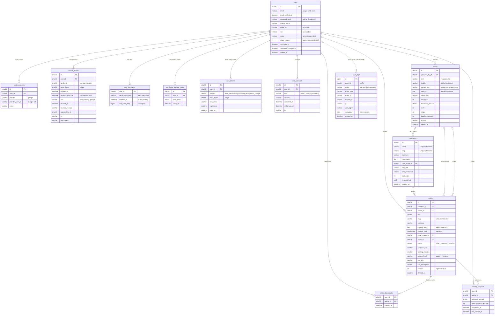

# Database

MySQL 8 holds everything permanent. Redis holds only short-lived, rebuildable data. This file is the reference for both. Update it in the same branch as any schema change.

- **ORM:** Sequelize 6 (`backend/src/db/models/`)
- **Migrations:** Umzug (`backend/src/db/migrations/`), recorded in the `schema_migrations` table
- **Seeds:** dev-only sample data (`backend/src/db/seeders/`), recorded in `schema_seeds`

---

## 1. Databases and users

| Database | Purpose |
|---|---|
| `NerveAndNectar` | App data |
| `NerveAndNectar_audit` | Append-only audit log |
| `NerveAndNectar_test` | Automated tests (wiped on every `npm run test:db`) |
| `NerveAndNectar_test_audit` | Test audit log |

| MySQL user | Rights | Used by |
|---|---|---|
| `nerve_app` | `SELECT, INSERT, UPDATE, DELETE` on app DBs; **`SELECT, INSERT` only** on audit DBs | The running API (two pools: the app DB, and a small one for the audit DB) |
| `nerve_migrator` | Plus `CREATE, ALTER, DROP, INDEX, REFERENCES` | `npm run db:migrate` and DB tests only |
| `root` | Everything | Never used by the app. The owner uses it once to run `create-db-users.sql`. |

Setup script: [`backend/src/db/setup/create-db-users.sql`](../backend/src/db/setup/create-db-users.sql).

---

## 2. Conventions

- **Engine and charset:** InnoDB, `utf8mb4` / `utf8mb4_0900_ai_ci` everywhere, so emoji and Hindi text work.
- **Names:** tables and columns in `snake_case`. Models use camelCase (`underscored: true` maps between them).
- **Primary keys:** UUID v7 in `CHAR(36)`. They're time-ordered (index-friendly) and not guessable. Generated in the app (`uuid` v7).
- **Times:** `DATETIME` in UTC (`timezone: '+00:00'`). Every table has `created_at`; most have `updated_at`.
- **Soft delete:** `users`, `conditions`, `articles` and `media` have `deleted_at` (Sequelize `paranoid`). Deleted rows are hidden from normal queries.
- **Unique among live rows:** a generated column `alive = IF(deleted_at IS NULL, 1, NULL)` plus `UNIQUE(col, alive)`. MySQL ignores NULLs in unique indexes, so soft-deleted rows don't block reusing a slug or email.
- **Allowed values:** stored as `VARCHAR` and enforced twice, by the model (`isIn`) and by a MySQL `CHECK` constraint. Values live in `src/config/constants.js`. Adding one means updating the constant and adding a migration that updates the CHECK.
- **Secrets:** stored only as SHA-256/HMAC hashes (`CHAR(64)`) or AES-256-GCM ciphertext. Never plain text.
- **Foreign-key errors:** MySQL may report errno 1216/1217 (older codes) instead of 1451/1452. `src/utils/dbErrors.js` handles all four (400 for a missing reference, 409 for "still in use").
- **Foreign keys:** owned data uses `ON DELETE CASCADE` (a user's sessions, 2FA, consents, bookmarks, progress). References use `SET NULL` (article → author, cover image). Required parents use `RESTRICT` (article → condition).

---

## 3. Entity relationship diagram



---

## 4. Tables

### Identity and security
| Table | Purpose | Key rules |
|---|---|---|
| `users` | Accounts for both roles | Email lowercased and trimmed; `password_hash` hidden by default (`withPassword` scope) and never serialised; `CHECK role IN ('user','admin')`; `token_version` invalidates every JWT when bumped |
| `oauth_accounts` | Google identities linked to a user | `UNIQUE(provider, provider_user_id)`, `UNIQUE(user_id, provider)` |
| `refresh_tokens` | One row per issued refresh token; `family_id` = one login session | Only the hash is stored; rotation sets `revoked_at` + `replaced_by_id`; `family_expires_at` caps the whole session |
| `user_two_factor` | TOTP secret per user | Encrypted with AES-256-GCM; hidden by default (`withSecret` scope); `last_used_step` blocks replay inside the 30 s window |
| `two_factor_backup_codes` | One-time recovery codes | Hashed; `used_at` marks single use |
| `auth_tokens` | Email verification, password reset, email change | Hashed, expiring, single-use (`used_at`) |
| `user_consents` | Terms, privacy and marketing acceptance with document version | Required by India's DPDP Act 2023 |

### Content
| Table | Purpose | Key rules |
|---|---|---|
| `conditions` | Groups articles (Migraine, Insomnia…) | Slug and name unique among live rows; `is_published` hides drafts |
| `articles` | The core content | Slug unique among live rows; `content_json` is the editor source, `content_html` is sanitised output; `published_at` required when published; `access_level` default `members`; `version` for optimistic locking; FULLTEXT index on `(title, summary)` for search |
| `media` | Uploaded images and audio | Storage key is server-generated (never the client's file name); `protected` media is served only through signed URLs |

### User dashboard
| Table | Purpose |
|---|---|
| `article_bookmarks` | Saved articles (composite PK `user_id, article_id`) |
| `reading_progress` | Scroll %, audio position, completion; indexed for "continue reading" |

### Audit (separate database)
| Table | Purpose | Key rules |
|---|---|---|
| `audit_logs` | Security and admin events: logins, 2FA changes, role changes, publishing | `nerve_app` can't UPDATE or DELETE; no FK to `users`, so entries outlive deleted accounts; `metadata` must never contain secrets |

### Planned (not built: see [plan.md](plan.md))
`plans`, `subscriptions`, `payments`, `webhook_events` (subscriptions); `guidance_requests`, `guidance_routines` (personal guidance); AI-assistant conversation tables. Today's schema already allows them: `access_level` can gain `subscribers`, and `ROLES` can gain `practitioner`.

---

## 5. Redis

Redis is an in-memory key-value store: very fast, but treated as **disposable**. If it's wiped, nothing permanent is lost.

- **Namespace:** every key starts with `nn:` (`redisKey()` in `src/config/redis.js`).
- **TTLs:** every key has one.
- **Eviction:** `maxmemory-policy noeviction`, so security counters are never silently dropped.
- **Databases:** dev uses DB index `0`, tests use DB `1`.

| Key pattern | TTL | Purpose | Status |
|---|---|---|---|
| `nn:rl:api:{ip}` | 15 min window | General rate limit (300 req / 15 min) | ✅ built |
| `nn:rl:auth:{ip}` | 15 min window | Strict auth rate limit (10 / 15 min) | ✅ built (wired to routes in auth phase) |
| `nn:cache:conditions:list` | 1 h | Published conditions | helper ✅, used in content phase |
| `nn:cache:article:{slug}` | 1 h | Published article payload | content phase |
| `nn:cache:articles:list:{hash}` | 5 min | Article list pages | content phase |
| `nn:auth:tv:{userId}` | 15 min | Cached `{tokenVersion, role, status}` for JWT checks | auth phase |
| `nn:auth:mfa:{sha256(ticket)}` | 5 min | Pending 2FA login, 5 attempts, single use | auth phase |
| `nn:auth:2fa-setup:{userId}` | 10 min | Encrypted secret during 2FA enrolment | auth phase |
| `nn:oauth:{sha256(state)}` | 10 min | Google OAuth `{codeVerifier, nonce, returnTo}`, single use | auth phase |
| `nn:lf:{…}` | 15 min – 24 h | Login-failure lockout counters (per IP + account) | auth phase |

---

## 6. Day-to-day commands (run in `backend/`)

| Command | What it does |
|---|---|
| `npm run db:migrate` | Apply pending migrations (as `nerve_migrator`) |
| `npm run db:migrate:status` | List applied and pending migrations |
| `npm run db:migrate:undo` | Roll back the last migration |
| `npm run db:seed` | Insert dev sample data (refused in production) |
| `npm run test:db` | Rebuild the **test** DB from migrations and run real MySQL + Redis tests |
| `docker compose up -d redis` | Start local Redis (needs Docker Desktop running) |
| `docker compose down` | Stop Redis (data kept in a Docker volume) |

### Looking inside
- **MySQL:** connect MySQL Workbench or the VS Code "MySQL" extension to `localhost:3306` as `nerve_app` (password in `backend/.env`) and open `NerveAndNectar`.
- **Redis:** RedisInsight (free GUI) on `127.0.0.1:6379` with the password from `backend/.env`, or:
  ```bash
  docker compose exec redis sh -c 'REDISCLI_AUTH="$REDIS_PASSWORD" redis-cli --scan --pattern "nn:*"'
  ```

---

## 7. Changing the schema

1. Add a new migration file `src/db/migrations/YYYYMMDDHHMMSS-description.js` with `up` and `down`. **Never edit a migration that has run anywhere shared.**
2. Update the model in `src/db/models/` to match. The DB test "models match the migrated columns" fails on drift.
3. Update this file (ERD + tables).
4. Run `npm run test:db`, which also checks that every migration rolls back and re-applies cleanly.
