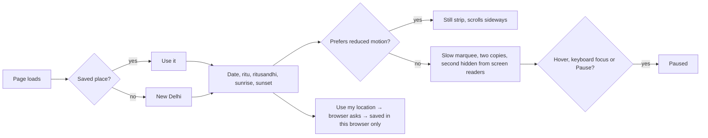

# Design refresh: professional, readable, clean

Branch `feature/season-strip-polish`, owner requests of 2026-10-29:
- "I do not like this today tab": replace it with a moving strip under the nav bar, coloured by the ritu.
- "I want the website to look professional … readable and clean".
- The Ritucharya page "looks unprofessional … like someone placed random boxes on the pages".
- "I want proper navigation".
- "Take references from the best blogging websites" ([detailed.com/50](https://detailed.com/50/)).

## What the reference sites have in common

From the list, the closest to a health and learning site are Men's Health, Harvard Business Review, Wired,
The Verge, Fast Company and Ars Technica. We take their shared patterns, not any one site's look:

| Pattern | What it means for Healthmarg |
|---|---|
| Simple header: logo, a few section links, account action at the right; a menu button on phones | Home · Articles · Ritucharya, then theme and Sign in / Join; "Menu" on phones and tablets |
| A thin ticker under the header (MarketWatch, CoinDesk, Seeking Alpha) | The **season strip**: date, ritu, sunrise, sunset, place, link; tinted by the ritu, pausable, still for reduced motion |
| Home leads with content, not decoration | Short hero, then **latest articles** (one lead story, then a list), then the Ritucharya feature |
| Sections divided by thin rules and headings, not boxes | No nested cards, thick coloured borders or filled tiles; hairlines and white space |
| A small coloured label (kicker) above each title | The condition name above article titles; the section name above page titles |
| One readable column for long text (~65–75 characters) | Article body and Ritucharya guidance in a column; long text left-aligned |
| Full footer | About line, Explore and Account columns, legal line |

## Rules (also in the design memory)

- Typography, white space and thin dividers structure the page, not boxes.
- No decoration behind headings or body text. Low-opacity line art may frame a section, never sit under text.
- Every colour passes the contrast test in all four themes; check 390 px width.
- Motion is calm and stops for reduced motion; anything that moves on its own can be paused (WCAG 2.2.2).

## Flow: the season strip

## Order of work

1. Navigation: header, phone menu, footer.
2. Season strip (replaces the Today card).
3. Home page: short hero, latest articles, Ritucharya feature.
4. Ritucharya page without boxes; styled language switch.
5. Articles list and article page: kickers, reading column, rules instead of cards.
6. Tests at every stage: unit → integration → performance/load → security → regression; then push.
