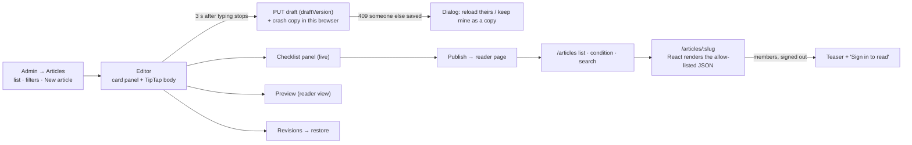

# Editor and reader pages (branch 4: `feature/article-editor`)

The last branch before launch (owner, 2026-10-27). It puts the articles API ([articles.md](articles.md)) on screen.

**Admin:**
- the Articles list;
- the article editor (writing, designing, the thumbnail, publishing, revisions).

**Readers:**
- the article list;
- the article page.

## Flow

## Pieces

| Part | What | Notes |
|---|---|---|
| Shared body types | The node and mark names of the allow-list (`document.js`), as TypeScript types | One source of names for editor and reader |
| Reader renderer | `ArticleBody`: a React component per node type, no HTML strings | `dangerouslySetInnerHTML` stays banned (lint). Unknown nodes render nothing. Links get `rel="noopener noreferrer nofollow"` and https/mailto only (checked again on the client) |
| Reader pages | `/articles` (cards, condition chips, search, "Load more"); `/articles/:slug` (cover with focal point, verse, callouts, images with blur placeholders, "Also read" cards, related, reading time, disclaimer) | Members teaser shows title, description and cover with "Sign in to read". Old address → `navigate(redirect)` |
| Editor | TipTap 3.32.0 (≥ 2 weeks old): StarterKit trimmed to the allow-list, plus custom callout, verse, divider, image, "Also read" card and article-link | **Lazy admin-only chunk** with its own budget; reader pages never load it |
| Sanitiser | Before sending, keep only allowed attributes (TipTap adds `target`, `rel`, `class`, list `type`…) | A **contract test** runs the editor's output through the server's own `document.js` |
| Autosave | 3 s debounce, `draftVersion`, crash copy in `localStorage`, "Saved · 12:04" status, retry on network errors | A 409 shows a dialog; nothing is overwritten silently |
| Card panel | Title, description (counter 40–300), web address, condition, who can read, language, accent, thumbnail (Media library picker, focal point by clicking), related (up to 6) | |
| Publish bar | Checklist (blocking and warnings), Preview, Publish / Publish changes, Unpublish, Archive, Discard changes, Delete; confirm when other articles link here | |

## Done when

- **Tests:** page tests for the editor, autosave conflicts, publish and the checklist, the reader (full / teaser / redirect / unpublished link as plain text), and the renderer refusing unknown nodes; the contract test.
- **Budgets:** the bundle budget, plus a check that reader pages don't load the editor chunk.
- **Browser:** an end-to-end publish in Edge, and screenshots in all 4 themes at 390 px.
