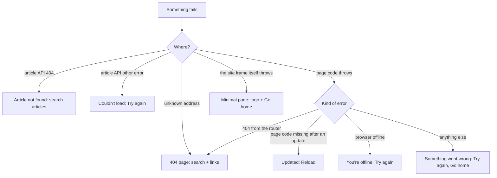

# Error pages

Branch `feature/error-pages`, owner request 2026-10-29: "Design the error page, for what you know".

## The errors the site can meet

| # | When | Before | Now |
|---|---|---|---|
| 1 | Unknown address (404) | One line and a mandala | **Page not found**: big "404", search box, links to Home, Articles, Ritucharya |
| 2 | Article address that doesn't exist | Its own style | Same design: "We couldn't find that article", search articles |
| 3 | Article couldn't load (server or network) | Red alert and a button | Same design: what happened, **Try again**, Browse articles |
| 4 | A bug crashes a page | **The router's raw developer screen** | **Something went wrong**: "not your fault", **Try again**, Go home; header and footer stay |
| 5 | The site was updated while a tab was open (old page code is gone) | Raw developer screen | **Healthmarg has been updated**: **Reload** (one click fixes it) |
| 6 | No internet | Each page's own message | A slim **"You're offline"** notice under the header, gone when back online; crash pages caused by a lost connection say "You're offline" |

## Design

- The same editorial style as the rest of the site: a large serif code ("404"), a plain headline, one short paragraph saying what happened and what to do, then clear buttons.
- No technical details are shown to readers: no stack traces or error text. In development the error is logged to the browser console.
- Errors inside a page keep the site's header, season strip and footer, so readers can carry on navigating. If the frame itself fails, a minimal page with the logo and a "Go home" link is shown instead.
- Readable in all four themes and at 390 px. Nothing animates.

## Flow

