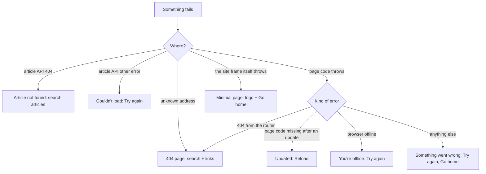
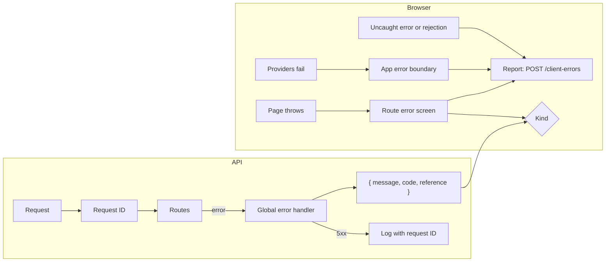

# Error pages

Branch `feature/error-pages`, owner request 2026-10-29: "Design the error page, for what you know".

## The errors the site can meet

| # | When | Before | Now |
|---|---|---|---|
| 1 | Unknown address (404) | One line and a mandala | **Page not found**: big "404", search box, links to Home, Articles, Ritucharya |
| 2 | Article address that doesn't exist | Its own style | Same design: "We couldn't find that article", search articles |
| 3 | Article couldn't load (server or network) | Red alert and a button | Same design: what happened, **Try again**, Browse articles |
| 4 | A bug crashes a page | **The router's raw developer screen** | **Something went wrong**: "not your fault", **Try again**, Go home; header and footer stay |
| 5 | The site was updated while a tab was open (old page code is gone) | Raw developer screen | **Healthmarg has been updated**: **Reload** (one click fixes it) |
| 6 | No internet | Each page's own message | A slim **"You're offline"** notice under the header, gone when back online; crash pages caused by a lost connection say "You're offline" |

## Design

- The same editorial style as the rest of the site: a large serif code ("404"), a plain headline, one short paragraph saying what happened and what to do, then clear buttons.
- No technical details are shown to readers: no stack traces or error text. In development the error is logged to the browser console.
- Errors inside a page keep the site's header, season strip and footer, so readers can carry on navigating. If the frame itself fails, a minimal page with the logo and a "Go home" link is shown instead.
- Readable in all four themes and at 390 px. Nothing animates.

## Flow

## Global error handling (owner request: "create global exception handler and configure the error pages accordingly")

### Backend: one handler for every request

- **Request ID:** every request gets a random ID, sent back in the `X-Request-Id` header and used in logs and the audit log. Before this, the field existed but was never filled in.
- **One response shape:** `{ "error": { "message", "code", "details"?, "reference"? } }`. **Every** error now has a `code`, so the website can choose the right page:

  | Status | Default code | When |
  |---|---|---|
  | 400 | `BAD_REQUEST` / `VALIDATION_FAILED` / `INVALID_JSON` | Wrong input, broken JSON |
  | 401 | `UNAUTHORIZED` | Not signed in |
  | 403 | `FORBIDDEN` | Signed in, but not allowed |
  | 404 | `NOT_FOUND` | No such address or item |
  | 409 | `CONFLICT` / specific | Changed by someone else, already exists |
  | 413 | `PAYLOAD_TOO_LARGE` | Body too large |
  | 429 | `RATE_LIMITED` (+ `Retry-After`) | Too many requests |
  | 500 | `INTERNAL_ERROR` (+ `reference`) | A bug on our side |
  | 503 | `SERVICE_UNAVAILABLE` (+ `Retry-After`, `reference`) | Database or cache unreachable |

- **Server errors carry a `reference`** (the request ID). Readers see it on the error page and can quote it; it finds the full log entry. No internal details are ever sent.
- **Database or Redis unreachable → 503 "temporarily unavailable, try again shortly"**, not a bare 500.
- **Crashes the browser reports:** `POST /api/v1/client-errors` logs what went wrong in a visitor's browser. It is size-limited, rate-limited and stores no personal data: query strings and tokens are removed, and only the address path is kept.
- The process-level handlers (unhandled rejection or exception: log, then exit for the process manager to restart) stay as they are.

### Website: one catch-all, and the right page for each error

- **Global listeners** catch uncaught errors and failed background promises. They report them to the backend (at most a few per page load, duplicates skipped) instead of losing them silently. Page code that fails to load after an update is reported too.
- **An app-wide error boundary** around everything, including the theme and sign-in providers, shows a standalone error page if even those fail.
- **API errors that reach the error screen** get the matching page:

  | Kind | Page |
  |---|---|
  | 404 | Page not found |
  | 403 | You don't have access (sign in with another account, or go home) |
  | 429 | Too many requests: wait N seconds |
  | 503 | Temporarily unavailable: try again shortly (reference) |
  | 500, or any other bug | Something went wrong (reference) |
  | Missing page code | Healthmarg has been updated: Reload |
  | No connection | You're offline |

