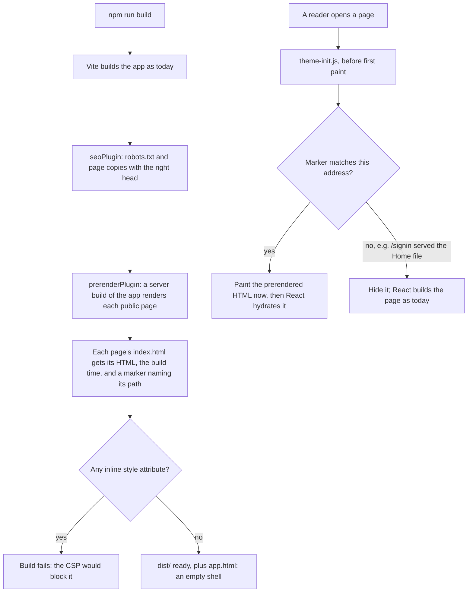

# Page speed

Owner request, 2026-11-04: make the public pages fast on phones. Every test run put them over Google's
2.5 s "good" line for the largest content to appear (LCP) on a mid-range phone (Slow 4G, CPU 4× slower):
Home about 2.6 s, articles about 2.9 s, Ritucharya about 3.4 s.

## What the measurements showed

Measured in Edge on the production build, Slow 4G, a 390 px phone screen, cold cache.

| When | What happens |
|---|---|
| 0.2 s | The HTML has arrived. It is an empty shell: nothing to show yet. |
| 1.1 s | The main script (91 KB compressed) has downloaded. Files are already compressed, so compression is not the problem. |
| 1.1–1.6 s | The browser reads and runs the app's code (about 170 ms), then React builds the page (270–420 ms). |
| 1.6–2.4 s | The first layout: 330 ms on Ritucharya and articles, 500–900 ms on Home. |
| 2.0–2.6 s | First paint. Until here the reader sees a blank page. |
| 2.7–3.2 s | Ritucharya's lead paragraph paints again when its second font file (accented letters such as ṛ) arrives. That font is only requested once the text is on screen. |

Things that turned out **not** to be the cause: page size (200–600 elements; a warm layout takes 1–4 ms),
compression, web fonts blocking paint, and decorative effects (not on these pages). About 200 ms of Home's
first layout is the browser finding a system font for its Devanagari text the first time.

**The real cost:** the reader waits for the whole app to download, run and lay out before anything appears,
and a lazily loaded page (Ritucharya, an article) adds another round trip after that.

## Decision: build the public pages' HTML in advance (prerendering)

At build time, React renders Home, Ritucharya, Articles, Terms and Privacy to HTML, and that HTML goes into
each page's file. The browser can paint the text as soon as the HTML and CSS arrive (about 0.6 s on Slow 4G),
and finds the fonts early. The app then **hydrates**: React takes over the existing HTML instead of building
it again.

Why this and not smaller tweaks: CSS experiments (no `optimizeLegibility`, no hidden typing lines, no web
fonts) each moved Home by less than the 200–400 ms the same page varies by between runs. Prerendering
removes the whole wait for the code before first paint. It also gives search engines and readers without
JavaScript the real text of these pages, which [seo.md](seo.md) listed as not done.

No new packages: React 19 (`react-dom/static`) and React Router 8 (static router) already do this.

## Rules that keep hydration correct

React must draw exactly the HTML that was prerendered, then change what differs. A mismatch makes React
throw the HTML away and log an error, which loses the gain.

| Depends on the visitor | Before hydration (and in the prerendered HTML) | After |
|---|---|---|
| Today's date: season strip, Home's season card, Ritucharya's "Now", the footer year | The build time, carried in the page | The real date. Normally nothing changes |
| The chosen season on Ritucharya (`?ritu=`, `?lang=`) and its tabs | Intro and tabs, no season selected; the season's details appear after | The requested or current season |
| Saved location (season strip) | New Delhi | The saved place |
| Saved theme in the theme switcher | Drawn by CSS from `data-theme`, which `theme-init.js` sets before paint | Same: React never draws the theme name |
| Reduced motion (typing animations) | Moving, with a Pause button | Still, no Pause button, full text |
| Signed in or not | "Loading" placeholder, as today | The real account links |

**No inline `style` attributes in prerendered HTML.** The recommended CSP (`default-src 'self'`) blocks them, and
React does not reapply them after hydration, so the page would stay unstyled there. The logo size and the theme
swatches move to CSS classes. The build fails if any prerendered page contains `style="`.

**No unfinished sections.** React normally moves a large section to the end of the page and reveals it
with an inline script; the CSP blocks that script, which would leave the page on its loading spinner. The
prerender keeps everything in order (`progressiveChunkSize: Infinity`), and the build fails if a page has an
inline `<script>` or a section React did not finish (`<!--$?-->`, `<!--$!-->`).

**A page's own code before hydrating.** Ritucharya, Articles, Terms and Privacy are loaded on demand. If React
took a page over while its code was still on the way, the first update (the sign-in check) would make it throw
the prerendered HTML away and build it again, silently. So each page links its code and CSS in its `<head>`
(they download alongside the main script), and the browser loads that code before hydrating. The tests check
that the prerendered heading is still the same element afterwards.

**Fonts.** The page links the Latin files of the heading and body fonts with `<link rel="preload">`, so the
text paints in them instead of a fallback that later swaps and shifts the text.

**Wrong file for an address.** Static hosts answer unknown addresses (such as `/signin`) with `index.html`,
which is now Home's prerendered page. Each prerendered file names its path in `<meta name="hm-prerendered">`.
`theme-init.js` compares it with the address before first paint and hides the HTML if it doesn't match; the app
then starts empty, as it does today. The build also writes `dist/app.html`, an empty shell, for hosts that can
use it as their fallback. The API removes prerendered HTML from the template it uses for article pages.

## Priority order

1. **Hydration-safe components:** one clock (`useNow`) and one `useHydrated` flag; season strip, Home, Ritucharya,
   footer year, typing animations, theme switcher; logo and swatches without inline styles.
2. **Prerender at build:** the plugin, the server entry, `app.html`, the path marker, the inline-style check.
3. **Start-up:** hydrate when the marker matches, otherwise build the page as today; `theme-init.js` hides a
   mismatched page before paint.
4. **API:** strip prerendered HTML from the article template.
5. **Tests:** hydration with no mismatch for every prerendered page under a different date, a saved theme,
   reduced motion, a saved place, a session hint and `?ritu=`; the plugin; `theme-init.js`; the API template.
   In the browser: no console or CSP errors (the preview server sends the recommended CSP), JavaScript off shows
   the text, and page speed before and after.
6. **Docs:** this file, `seo.md` and the feedback log.

## Host settings at launch

| Need | Why |
|---|---|
| Serve a folder's `index.html` for its address without a trailing slash: `/ritucharya` → `ritucharya/index.html` | Otherwise the host answers with Home's file; theme-init.js hides it and the app builds the page, which works but loses the speed |
| Use `app.html` as the fallback for every other address, if the host allows it (Caddy: `try_files {path} {path}/index.html /app.html`) | Readers without JavaScript and simple crawlers then never get Home's text at `/signin`. With `index.html` as the fallback the site still works |
| `SITE_INDEX_HTML` can stay `frontend/dist/index.html` | The API takes the prerendered HTML out before it uses the file for an article page |

`vite preview`, which the browser tests use, behaves like a host with these settings (a small plugin maps the
addresses) and sends the recommended CSP, so the tests catch anything the CSP would block.

## Results

Edge, production build, real API on the test database. "Phone" is a 390 px screen on Slow 4G with the CPU
4× slower; LCP is when the largest content appears (Google's "good" line is 2.5 s), CLS is layout shift
("good" below 0.1).

| Page | Phone LCP before | Phone LCP after | First paint after | CLS after (phone / desktop) |
|---|---|---|---|---|
| Home | 2.5–2.8 s | **1.6 s** | 1.6 s | 0.003 / 0 |
| Ritucharya | 3.2–3.4 s | **2.0 s** | 2.0 s | 0.023 / 0 |
| Ritucharya, Hindi | about 3.5 s | **2.0 s** | 2.0 s | 0.023 / 0.011 |
| Articles list | 2.4 s | **1.4 s** | 1.4 s | 0.029 / 0.007 |
| An article | 2.9 s | 3.1 s (not prerendered yet) | 2.4 s | 0 / 0 |

The same page varies by 100–300 ms between runs on this machine. Tried and dropped: `content-visibility: auto`
on the sections below the screen (no measurable gain), and removing `text-rendering: optimizeLegibility`
(within the noise).

## Not in this change

- Article pages: the API already sends their head and `<noscript>` text; prerendering them needs the API to run
  React, which is a bigger step. They are the slowest page now, and the next thing to do.
- The articles list and Home's latest articles still load from the API after hydration.
