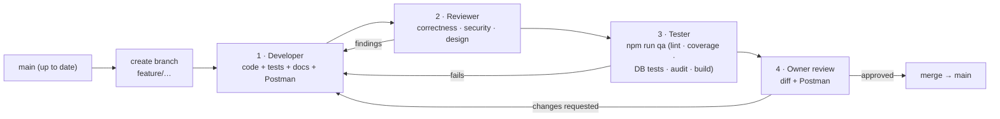

# Project Plan

The source of truth for **what gets built, in what order**. Each numbered step is one git branch, pushed to GitHub. Branches stack in order (each starts from the previous one) until they are merged. It goes Developer → Reviewer → Tester → **owner review** → merge ([workflow.md](workflow.md)), and updates the docs and the Postman collection in the same branch.

**Current scope:** `user` and `admin` roles, auth (JWT, Google OAuth, reCAPTCHA v3, 2FA), the user dashboard and the admin dashboard.
**Later:** subscriptions and payments, personal guidance, the AI assistant (personal 24/7 guide).

Status: ✅ done · 🔨 in progress · ⏳ next · ☐ planned

---

## 1. Roadmap

```mermaid
flowchart TD
    subgraph P0["P0 · Foundation"]
      A1["1 ✅ chore/repo-setup<br/>docs, workflow, security policy"]
      A2["2 ✅ chore/frontend-scaffold<br/>existing React app"]
      A3["3 🔨 feature/database-setup<br/>Sequelize models, migrations,<br/>MySQL + Redis connections, tests, docs"]
      A4["4 ☐ chore/api-hardening<br/>CORS details, request IDs, error codes,<br/>JSON-only, CSRF/Origin guard"]
    end
    subgraph P1["P1 · Authentication & security"]
      B1["5 ☐ feature/auth-core<br/>register, login, JWT + refresh rotation,<br/>RBAC, lockout, audit service"]
      B2["6 ☐ feature/auth-email-flows<br/>verify email, reset password (Mailpit)"]
      B3["7 ☐ feature/recaptcha-v3"]
      B4["8 ☐ feature/auth-2fa<br/>TOTP, backup codes, mandatory for admins"]
      B5["9 ☐ feature/google-oauth<br/>PKCE + state + nonce"]
      B6["10 ✅ feature/frontend-auth<br/>pages, auth context, route guards, themes"]
    end
    subgraph P2["P2 · Content & dashboards"]
      C1["11 ☑ feature/conditions"]
      C2["12 ☑ feature/media-images"]
      C3["13 ☐ feature/articles-api"]
      C4["14 ☐ feature/admin-dashboard<br/>editor, media, users, audit log"]
      C5["15 ☐ feature/user-dashboard<br/>reader, bookmarks, progress, account security"]
      C6["16 ☐ feature/article-audio<br/>upload, signed streaming, player"]
    end
    subgraph P3["P3 · Launch readiness"]
      D1["17 ☐ feature/legal-pages"]
      D2["18 ☐ chore/security-hardening<br/>CSP enforce, ASVS pass, ZAP scan"]
      D3["19 ☐ chore/backups-ops"]
      D4["20 ☐ chore/deploy-config"]
    end
    subgraph LATER["Later (designed for, not built)"]
      L1["Subscriptions & payments"]
      L2["Personal guidance"]
      L3["AI assistant"]
    end

    A1 --> A2 --> A3 --> A4 --> B1
    B1 --> B2 --> B3 --> B4 --> B5 --> B6
    B6 --> C1 --> C2 --> C3 --> C4 --> C5 --> C6
    C6 --> D1 --> D2 --> D3 --> D4
    D4 -.-> L1 -.-> L2 -.-> L3
```

### ▶ Building now: **#3 `feature/database-setup`**
Foundation first: every later feature reads and writes this schema, so it has to be right before auth or content.

---

## 2. Phase details

### P0 · Foundation

| # | Branch | Delivers | Done when | Owner action |
|---|---|---|---|---|
| 1 | `chore/repo-setup` ✅ merged | `.gitignore`, `.gitattributes`, `.editorconfig`, README, workflow, security docs, PR template | Pushed for review | Review → approve merge |
| 2 | `chore/frontend-scaffold` ✅ merged | Existing React app (17 tests, build green) | Pushed for review | Review |
| 3 | `feature/database-setup` 🔨 | Sequelize config + 13 models; 5 migrations (incl. CHECKs, `alive` uniques, separate audit DB); seed; Redis client, cache, Redis rate-limit store; `/health` reports MySQL + Redis; architecture/api/database/plan docs; Postman collection | `npm run qa` green, incl. `test:db` against real MySQL + Redis | Run `create-db-users.sql` as root; start Docker Desktop |
| 3a | `chore/rename-healthmarg` 🔨 | Project renamed from "Nerve and Nector" to **Healthmarg**: package names, UI text, docs, Postman, databases (`healthmarg`, `healthmarg_audit`, `…_test`) and DB users (`healthmarg_app`, `healthmarg_migrator`) | No old name left outside the history logs | Run the new `create-db-users.local.sql` as root |
| 3b | `chore/frontend-typescript` | Frontend moved to strict TypeScript (`.tsx`), `tsc --noEmit` in `npm run qa` | Typecheck, lint, tests and build green | — |
| 4 | `chore/api-hardening` | Explicit CORS (methods, headers, `maxAge`), `X-Request-Id` + pino-http, error `code`s, Sequelize error mapping, remove urlencoded (JSON-only), `requireJson`, `originGuard`, `TRUST_PROXY_HOPS`, CORP `same-site` | Tests for each guard | — |

### P1 · Authentication & security
| # | Branch | Delivers | Owner action |
|---|---|---|---|
| 5 | `feature/auth-core` ✅ built | Also absorbed steps 6–8 (email flows, reCAPTCHA v3, 2FA): argon2id + HIBP, `jose` access JWT (15 min, `token_version`), refresh rotation + reuse detection (HttpOnly cookie + CSRF), lockout, `authenticate` / `requireRole` / `requireMfa`, audit service, email verification + reset (dev outbox), TOTP 2FA with backup codes (mandatory for admins), `/users/me`, admin bootstrap (`/admin/setup` + setup code), admin stats/users/audit API. 188 tests, 94.7% merged coverage, load + attack suites | Later: reCAPTCHA keys, SMTP |
| 6 | ~~`feature/auth-email-flows`~~ done in #5 | nodemailer + templates, email verification, forgot/reset password, breached-password check | — |
| 7 | `feature/recaptcha-v3` (server side done in #5; frontend hook in #10) | `requireRecaptcha(action, minScore)`, test mode for automated tests | **Create a reCAPTCHA v3 key** (localhost + prod domain) |
| 8 | `feature/auth-2fa` (TOTP, backup codes, admin enforcement done in #5; session list + disable later) | TOTP (`otpauth`), AES-256-GCM secret, backup codes, login step-up, mandatory for admins, session list | Back up `TWO_FACTOR_ENC_KEY` offline |
| 9 | `feature/google-oauth` | `openid-client` PKCE flow, safe linking rules | **Create a Google OAuth client** + consent screen |
| 10 | `feature/frontend-auth` ✅ built | Healthmarg design system (4 themes, in-house animated components, mandala/lotus motifs, Devanagari accents), home, sign-up, sign-in + 2FA step, verify email, forgot/reset password, member dashboard (profile, 2FA, sign out everywhere), `/admin` (sign-in, first-time 2FA enrolment, overview, members, audit log), `/admin/setup`; in-memory session with single-flight refresh; guards; reCAPTCHA hook; bundle budget | Try it; later: reCAPTCHA site key |

### P2 · Content & dashboards

> **Content phase:** the full design, flowcharts and decisions are in [content.md](content.md) (design panel, 2026-10-26). Translation is free, in the browser (owner decision).

| # | Branch | Delivers | Owner action |
|---|---|---|---|
| 11 | `feature/conditions` ✅ built | Conditions (what each article is about): admin CRUD, public cached list, admin page | Provide the condition list |
| 12 | `feature/media-images` ✅ built | Image pipeline: multer, magic bytes, sharp → WebP (EXIF/GPS stripped), storage adapter, media library | Brand images |
| 13 | `feature/articles-api` | Drafts/live, autosave, publish checklist, revisions, references, public article API + cache | 3–5 sample articles |
| 14 | `feature/article-editor` | TipTap 3 editor, blocks, thumbnail designer, references panel, preview, reader page (React renderer, no raw HTML) | — |
| 14a | `feature/editor-speech` | Dictation + listen back (browser speech, free) | — |
| 14b | `feature/translations` | Admin translation (browser translator → review → publish) + reader switcher, listening and instant translation | — |
| 15 | `feature/user-dashboard` | Bookmarks, continue reading, account and security settings | — |
| 16 | `feature/media-audio-video` | Audio + video upload (ffmpeg remux, GPS stripped), signed streaming with Range, narration recording | **Install ffmpeg** |

### P3 · Launch readiness
| # | Branch | Delivers | Owner action |
|---|---|---|---|
| 17 | `feature/legal-pages` | Terms, Privacy, Medical disclaimer, Contact | Lawyer-reviewed texts |
| 18 | `chore/security-hardening` | Enforced CSP, `security.txt`, OWASP ASVS L2 checklist, ZAP baseline scan | — |
| 19 | `chore/backups-ops` | Nightly encrypted DB backups + tested restore, uptime check | Storage bucket |
| 20 | `chore/deploy-config` | Dockerfile (non-root), production compose (API, MySQL, Redis, Caddy), deploy doc | Domain, VPS |

### Later
Subscriptions and payments (Razorpay), personal guidance (practitioner role, consent, encrypted intake), and the AI assistant. Each gets its own design pass and plan section before any code.

---

## 3. How each step flows

---

## 4. Definition of done (every branch)
- [ ] Code follows the module structure; frontend and backend stay separate
- [ ] Reviewer findings fixed or accepted with a reason
- [ ] `npm run qa` green in every app the branch touches, coverage ≥ 80% lines (security code ≥ 90%)
- [ ] Abuse cases tested (bad input, missing auth, wrong role, rate limits)
- [ ] `docs/` updated (architecture / api / database / plan status)
- [ ] Postman collection updated for any API change
- [ ] No secrets in the diff
- [ ] Owner reviewed and approved the merge

---

## 5. Risks

| Risk | Mitigation |
|---|---|
| Redis is a single point of failure | Cache and general limit fail open; auth fails closed; `/health` monitoring; AOF persistence |
| Sequelize 6 is in maintenance mode | Pinned; models accessed through services so a later ORM move stays contained |
| Shared mobile IPs in India trigger lockouts or low reCAPTCHA scores | Limits keyed by IP + account; tunable thresholds; login fails open on captcha errors, guarded by lockout |
| Health-related content and claims | Medical disclaimer, careful wording, legal review before launch |
| Lost encryption keys (2FA) | Offline backup is an owner action; ciphertext is versioned for key rotation |
| Solo developer | Small branches, written definition of done, owner review on every merge |
