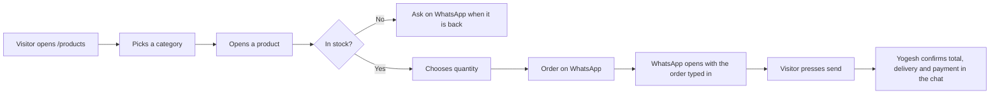
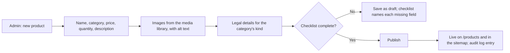

# Products: a catalogue with ordering on WhatsApp

Owner request, 2026-11-13: a Products page. The admin adds products with a description, images and the other
details an online shop shows, and people order by contacting Yogesh Upadhyay on WhatsApp. Online payment comes
later.

Categories the owner expects (to be confirmed): daily-routine products from toothpaste to herbs, personal care,
"medicare with consultancy", flour mixes, and skin and health care.

**Status: plan only. Nothing is built yet.** The questions at the end decide parts of it.

## What gets built

| Where | What |
|---|---|
| `/products` | The catalogue: categories as tabs, a grid of products (cover image, name, quantity, price), "Out of stock" shown plainly. Prerendered page frame; products load from the API, like `/articles` |
| `/products/:slug` | One product: images (swipe on a phone), price "inclusive of all taxes", quantity, description, ingredients, how to use, the legal details for its category, and the **Order on WhatsApp** button. Search engines get a built HTML page with `Product` structured data, like articles do |
| Admin → Products | List, search and filter by category and status; an editor with a checklist that blocks publishing until the details the law asks for are filled in; draft, publish, unpublish, archive |
| Admin → Product categories | Add, rename, reorder and hide categories; each category has a *kind* (food, cosmetic, Ayurvedic medicine, general, consultation), which decides which legal fields its products must have |
| Images | The existing media library and image pipeline (resized WebP, blurred placeholder, alt text required). A product has 1–8 images; the first is the cover |
| Header and Home | A "Products" link; a short "From our shelf" strip on Home once there are published products |
| Sitemap | `/products` and every published product |

### Ordering on WhatsApp

The button opens `https://wa.me/918982579178?text=…` with the order typed in:

> Namaste! I would like to order: Triphala Churna, 100 g × 2 (₹180 each). [link to the product page]

The visitor can change the quantity on the page before pressing the button. Nothing is sent until they press
send in WhatsApp, and the site stores nothing about them: no account, no form, no personal data. The price
shown is the price on the site at that moment; Yogesh confirms the total, delivery charge and payment in the
chat.

Later (its own branch, once the owner wants it): a **basket** kept in the visitor's browser, so several products
go in one WhatsApp message. Then online payment.

## What the law asks for each kind of product

Healthmarg sells from its own stock through its own website, so it is an *inventory e-commerce entity* and a
*seller* at once. Checked against the sources listed at the end. **These are summaries for planning, not legal
advice. Before launch, the owner should confirm the points marked "check" with a CA or the state licensing
office.**

### Every product

| Rule | What the site must do | How the plan does it |
|---|---|---|
| Consumer Protection (E-Commerce) Rules, 2020 | Show the seller's legal name, **full address**, contact details and a **grievance officer** (name, contact), who acknowledges a complaint within 48 hours and resolves it within one month. Show return, refund, exchange, delivery and payment terms, the total price with any charges, and the **country of origin** | A "Seller details" block on every product page and a `/shop-policy` page; all values in `business.ts`. Products get a required country-of-origin field |
| Legal Metrology (Packaged Commodities) Rules, 2011, rule 6(10) | Online listings must show the label's mandatory declarations except the month and year of packing: **name and address of the manufacturer or packer** (or importer), **common name**, **net quantity**, **MRP inclusive of all taxes**, customer-care details, country of origin | Required fields: manufacturer/packer name and address, net quantity and unit, MRP. The price line reads "MRP ₹… (inclusive of all taxes)". Imported products: a 2026 amendment (rule 6(10A), from 1 July 2026) adds duties; we flag imported items in the checklist (check the text if any are imported) |
| CCPA misleading-advertisement guidelines (2022) and dark-pattern guidelines (2023) | No false urgency ("only 2 left!"), no hidden charges, no fake discounts or reviews | No countdowns or stock counts; any "was" price must be a real earlier price the admin entered; no reviews until they are real and moderated |
| Drugs and Magic Remedies (Objectionable Advertisements) Act, 1954 | No claim that a product cures or prevents the diseases in its schedule (diabetes, obesity, heart disease and others) | The editor checks the text for cure words in English and Hindi, as the About tests do, and the checklist blocks publishing until they are removed. Product pages carry the medical note |

### By kind

| Kind | Examples | What applies | What the listing needs |
|---|---|---|---|
| **Food** | Flour mixes, herbs and spices sold as food, herbal teas | FSSAI: every food seller needs a registration or licence. The FSSAI e-commerce advisory (Dec 2024) asks for the seller's FSSAI number on the listing and that online claims match the physical label (Labelling and Display Regulations, 2020). Foods sold as "Ayurveda aahara" have their own FSSAI regulations (2022) | **FSSAI number of the seller** (currently "applied for": food products stay unpublishable until the 14-digit number is in `business.ts`), the **manufacturer's FSSAI number**, ingredients, veg/non-veg mark, allergens, best-before or shelf life, storage. A photo of the label |
| **Cosmetic** | Toothpaste, tooth powder, soap, oils and creams for skin and hair | Cosmetics Rules, 2020: a seller may only sell cosmetics made by a **licensed manufacturer** and labelled as the Rules require. No separate retail licence was found for cosmetics (check with the state drug controller) | Manufacturer name, address and **manufacturing licence number**, ingredients, how to use, net quantity, expiry or use-before date |
| **Ayurvedic medicine** | Churnas, vatis, asavas and other classical or proprietary Ayurvedic medicines | Drugs and Cosmetics Act, Chapter IVA, and the Rules for Ayurvedic, Siddha and Unani drugs: the **manufacturer** needs an AYUSH manufacturing licence; labels carry it. Medicines with **Schedule E(1)** (poisonous) ingredients must be labelled "Caution: to be taken under medical supervision", and the CCPA told online sellers (July 2022) to sell them only against a registered practitioner's prescription. Whether a **retailer** of Ayurvedic medicines needs a state licence is disputed between sources: section 33A excludes them from Chapter IV, but some states expect one (**check with the Madhya Pradesh AYUSH licensing authority**) | Manufacturer, **AYUSH manufacturing licence number**, ingredients with quantities, dosage as on the label, a "Schedule E(1)" switch: when on, the page says "To be taken under medical supervision" and the button becomes **Ask about this medicine** (no direct order). No disease claims beyond the label's approved indications |
| **General** | Copper bottles, neti pots, yoga mats | Consumer Protection and Legal Metrology rules above | The common fields |
| **Consultation** ("medicare with consultancy") | An Ayurvedic consultation on WhatsApp or video | Only a **registered Ayurveda practitioner** (BAMS or equal, registered with a state board / NCISM) may advise patients. The CCIM telemedicine guidelines (2020) for Ayurveda, Siddha and Unani require the practitioner's identity and registration to be known, the patient's consent, and set rules for prescribing remotely (check for a newer NCISM version) | A practitioner profile: name, qualification, **registration number and board**. Listed only once a practitioner is named. The button is **Book a consultation** on WhatsApp. No price-for-cure language |

**If Healthmarg makes or packs products itself** (for example its own flour mix or churna), more licences apply:
an FSSAI *manufacturing* registration or licence (the current application is as a retailer), an AYUSH
manufacturing licence for medicines, a cosmetics manufacturing licence, and the label rules for each. The
catalogue works either way; the fields just name Healthmarg as manufacturer or packer.

## Data

New tables, by migration (`backend/src/db/migrations`):

| Table | Columns (main ones) |
|---|---|
| `product_categories` | `id`, `slug` (unique), `name`, `name_hi`, `description`, `kind` (food, cosmetic, ayurvedic_medicine, general, consultation), `sort_order`, `is_visible`, timestamps |
| `products` | `id`, `slug` (unique), `category_id`, `name`, `name_hi`, `summary` (≤ 200 chars), `description` (plain paragraphs, no HTML), `price_paise` (integer; MRP incl. taxes), `compare_at_paise` (optional earlier price), `net_quantity`, `unit` (g, kg, ml, l, pieces, minutes), `in_stock`, `status` (draft, published, archived), `country_of_origin`, `manufacturer_name`, `manufacturer_address`, `ingredients`, `how_to_use`, `shelf_life`, `storage`, `fssai_number`, `licence_number`, `is_veg`, `allergens`, `schedule_e1`, `published_at`, `version` (stops two admins overwriting each other), `created_by`, `updated_by`, timestamps |
| `product_images` | `product_id`, `media_id`, `sort_order` (0 = cover). Alt text comes from the media library, where it is required |
| `product_slug_redirects` | Old slug → product, so a renamed product's old link still works (as articles do) |

Prices are whole paise, never decimals. Names and descriptions are stored as plain text and escaped on output,
so nothing typed into the admin can run as code on the site.

## API

Public (cached, no sign-in):

| Method | Path | Returns |
|---|---|---|
| GET | `/api/v1/products/categories` | Visible categories, in order |
| GET | `/api/v1/products?category=&cursor=&limit=` | Published products, cover image, price, quantity, stock; cursor paging |
| GET | `/api/v1/products/:slug` | One published product with images and legal details; 301 from an old slug |

Admin (inside the existing admin gate: signed in, admin role, two-step verification; every change in the audit
log; rate limited; checked with zod):

| Method | Path | Does |
|---|---|---|
| GET, POST | `/api/v1/admin/product-categories` | List, add |
| PATCH, DELETE | `/api/v1/admin/product-categories/:id` | Edit, delete (refused while products use it) |
| GET, POST | `/api/v1/admin/products` | List with filters; add a draft |
| GET, PATCH | `/api/v1/admin/products/:id` | Read; save (needs the current `version`) |
| GET | `/api/v1/admin/products/:id/checklist` | What is missing before it can be published |
| POST | `/api/v1/admin/products/:id/publish`, `/unpublish`, `/archive` | Status changes |
| PUT | `/api/v1/admin/products/:id/images` | Set the images and their order |
| DELETE | `/api/v1/admin/products/:id` | Delete a draft (published ones are archived instead) |

The Postman collection in `backend/postman/` gets every route.

## Priority order

Each step is its own branch off `main`, through all six test stages (build, unit, integration, performance and
load, security, regression), and waits for your review before merging.

1. **`feature/products-api`**: migration, models, public and admin routes, checklist rules per kind, audit
   entries, Postman. Load test on the public list and product routes; hostile requests (bad slugs, huge
   bodies, HTML in text, negative or fractional prices, other users' tokens, missing 2FA).
2. **`feature/products-admin`**: the admin category manager and product editor, with the checklist and image
   picker. Checked in all four themes and at 390px.
3. **`feature/products-pages`**: `/products`, `/products/:slug`, the WhatsApp order button with quantity,
   seller details, `/shop-policy`, header link, Home strip, search details, `Product` structured data,
   sitemap, prerendering of `/products`. Page-speed check on Slow 4G.
4. Later, when you ask: basket in the browser; online payment; reviews.

## Questions for the owner

These change what is built, so they are needed before step 3 at the latest:

1. **Which categories are real**, and roughly how many products to start with?
2. **Does Healthmarg make or pack any product itself**, or only resell other companies' products? (Changes
   which licences are needed; see above.)
3. **Who gives the consultations**, and what is their Ayurveda registration number and board? Until then,
   consultations stay hidden.
4. **Full business address** and the **grievance officer** (it can be Yogesh Upadhyay) to show on product
   pages, as the e-commerce rules require.
5. **Delivery**: which areas, the delivery charge, and the return and refund terms for the shop-policy page.
6. **FSSAI**: food products cannot be published until the 14-digit registration number arrives.

## Sources

- [Consumer Protection (E-Commerce) Rules, 2020, summary](https://www.indialaw.in/guides/civil/consumer-protection-e-commerce-rules/)
  and [Khaitan & Co note](https://khaitanco.com/sites/default/files/2020-08/Stricter%20Regulations%20on%20E-Commerce%20%E2%80%93%20The%20Consumer%20Protection%20(E-Commerce)%20Rules,%202020.pdf)
- [Legal Metrology rule 6(10) for e-commerce](https://ssrana.in/articles/compliances-for-website-e-commerce-website/),
  [2017 amendment](https://www.mondaq.com/india/commoditiesderivativesstock-exchanges/662702/e-commerce-entities-legal-metrology-packaged-commodities-amendment-rules-2017),
  [2026 amendment](https://foxmandal.in/wp-content/uploads/2026/02/Legal-Metrology-Packaged-Commodities-Amendment-Rules-2026.pdf)
- [FSSAI advisory to e-commerce food businesses, Dec 2024](https://fssai.gov.in/upload/advisories/2024/12/674efa161d756Adobe%20Scan%203%20Dec%202024.pdf)
  and [summary](https://en.vikaspedia.in/viewcontent/health/nutrition/advisory-for-e-commerce-food-business-operators-on-strengthening-food-safety-compliance?lgn=en)
- [CCPA advisory on online sale of Ayurvedic, Siddha and Unani drugs, July 2022](https://en.vikaspedia.in/viewcontent/health/ayush/ccpa-issues-advisory-to-ecommerce-platforms-on-sale-of-ayurvedic-siddha-and-unani-drugs?lgn=en)
- [Online sale of medicines in India](https://www.scconline.com/blog/post/2023/11/02/regulation-of-online-pharmacies-in-india/);
  on retail licences for AYUSH medicines, the sources disagree: [no licence](https://setindiabiz.com/blog/is-ayush-license-needed-to-sell-ayush-drugs),
  [licence expected](https://www.corpseed.com/knowledge-centre/license-for-selling-ayurvedic-medicines)
- [Cosmetics Rules, 2020 (CDSCO)](https://cdsco.gov.in/opencms/resources/UploadCDSCOWeb/2022/cos_rules/Cosmetics%20Rules%202020.pdf)
- [CCIM Telemedicine Practice Guidelines for Ayurveda, Siddha and Unani, 2020](https://nmcn.in/oldsite/pdf/CCIM_Telemedicine_Guidelines_08-04-2020.pdf)
- [Drugs and Magic Remedies Act, 1954](https://en.wikipedia.org/wiki/Drugs_and_Magic_Remedies_(Objectionable_Advertisements)_Act,_1954)
