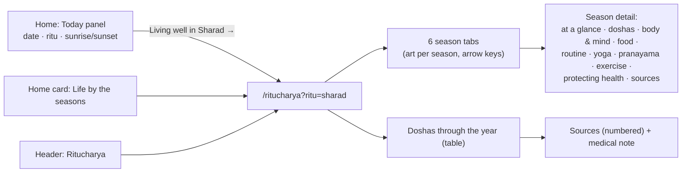

# Ritucharya: living by the six seasons (branch `feature/ritucharya`)

Owner request (2026-10-28):
- show the **current ritu, today's date, sunrise and sunset** on the left of the home page;
- replace the "Understand the root" card with **"Life by the seasons" (Ritucharya)**;
- a page with the **6 ritus**, each tab looking like its season;
- for each ritu: what to do, eat, which yoga, exercise and pranayama, and how to prevent common ailments (BP, diabetes, arthritis…);
- how **Vata, Pitta and Kapha** behave, and how body and mind feel physically, mentally and emotionally;
- references to the Yoga Sutras, the Bhagavad Gita, Ayurvedic texts and research papers.

## Calendar

| Ritu | Lunar months | Usual solar dates | Opened by |
|---|---|---|---|
| Shishira | Magha–Phalguna | 14 Jan – 14 Mar | Makara Sankranti |
| Vasanta | Chaitra–Vaishakha | 15 Mar – 14 May | Meena Sankranti |
| Grishma | Jyeshtha–Ashadha | 15 May – 15 Jul | Vrishabha Sankranti |
| Varsha | Shravana–Bhadrapada | 16 Jul – 16 Sep | Karka Sankranti |
| Sharad | Ashvina–Kartika | 17 Sep – 15 Nov | Kanya Sankranti |
| Hemanta | Margashirsha–Pausha | 16 Nov – 13 Jan | Vrishchika Sankranti |

The ritus follow the Sun's passage through the sidereal signs (Sankranti dates drift by about a day between years). **Ritusandhi** is the 7 days either side of a change. The dosha pattern follows Sushruta and Ashtanga Hridaya:
- **Vata:** builds up in Grishma, aggravated in Varsha, settles in Sharad.
- **Pitta:** builds up in Varsha, aggravated in Sharad, settles in Hemanta.
- **Kapha:** builds up in Shishira, aggravated in Vasanta, settles in Grishma.

## Sunrise and sunset

- **How:** the standard sunrise equation, computed in the browser. It is within about 2 minutes of published times; a test checks London's midsummer.
- **Where:** New Delhi by default. **"Use my location" asks the browser only when clicked.** The position is rounded to about 1 km and remembered only in that browser (`localStorage`); it is never sent to the server or any outside service.

## Sources (each checked to exist before citing)

- **Classical texts:**
  - Charaka Samhita, Sutrasthana 6;
  - Ashtanga Hridaya, Sutrasthana 3;
  - Sushruta Samhita, Sutrasthana 6;
  - Yoga Sutras 2.46 and 2.49–2.50;
  - Bhagavad Gita 6.16–6.17;
  - Hatha Yoga Pradipika, ch. 2.
- **Research:**
  - Alpérovitch 2009 (blood pressure higher in cold weather);
  - Tseng 2005 (HbA1c higher in winter);
  - Jena 2017 (*no* link between rain and joint pain: the page says so honestly);
  - Innes & Selfe 2016 (yoga for type 2 diabetes);
  - Chaddha 2019 (slow breathing lowers blood pressure modestly);
  - Rosenthal 1984 (seasonal low mood);
  - Thakkar 2011 (Ritucharya and lifestyle disorders).

## Needs the owner

- **Content review:** the content is health guidance. It is written cautiously: medicines are never to be changed without a doctor, and there are safety notes on Kapalabhati, Bhastrika and Sheetali. **The site's yoga practitioners / an Ayurveda doctor should review it before launch.**
- **Where it lives:** the content is in `frontend/src/features/ritu/ritucharya.ts`. Once the article editor ships (branch 4), it can move into an admin-editable article if wanted.
