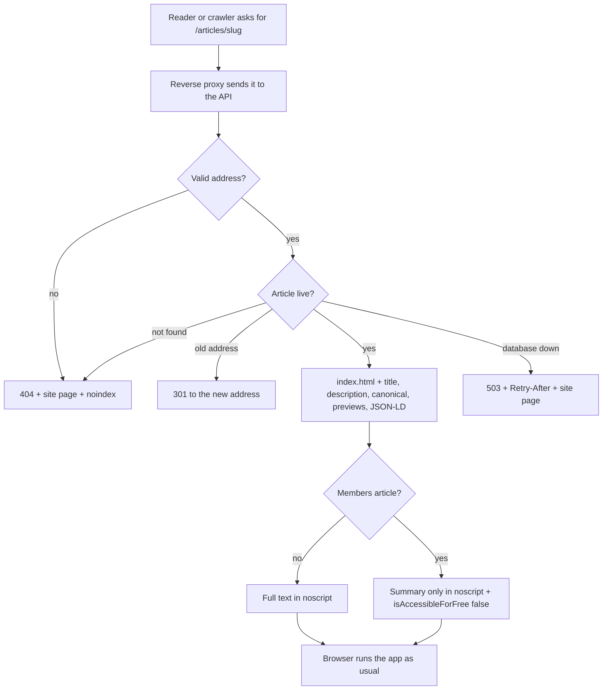

# Search engine optimisation (SEO)

Owner request, 2026-11-01: "Do the SEO (Search Engine Optimisations) also".

## Where we started

- One fixed title and description for the whole site in `index.html`.
- No `robots.txt`, no sitemap, no link previews (Open Graph), no structured data.
- Sign-in, dashboard and admin pages could be indexed.
- A missing article answered `200`, so search engines would treat it as a real page.
- Already in place: `seo_title` and `seo_description` on articles, editable in the admin editor; redirects from old article addresses; members articles send only a teaser.

## Decisions

| Decision | Reason |
|---|---|
| **One page for everyone; no bot-only version.** The server adds the right head and a `<noscript>` copy of the text to the same page. | Google calls [dynamic rendering](https://developers.google.com/search/docs/crawling-indexing/javascript/fix-search-javascript) a deprecated workaround. The same text is served to people and crawlers. |
| **Head tags are updated in one hook, `useSeo`,** not with React's `<title>` hoisting. | Hoisting adds a second `<title>` after the one in `index.html`, and browsers use the first. |
| **`noindex` on private pages; `robots.txt` does not block them.** | A crawler blocked by `robots.txt` never sees the `noindex`. |
| **Members articles stay teasers, marked `isAccessibleForFree: false`.** | That is [Google's paywall markup](https://developers.google.com/search/docs/appearance/structured-data/paywalled-content), and the hidden text never reaches the browser. |
| **No `MedicalWebPage`, `reviewedBy` or practitioner claims.** | Structured data must be a [true picture of the page](https://developers.google.com/search/docs/appearance/structured-data/sd-policies). No reviewer is shown on the site, so none is claimed. |
| **The author is the organisation** until articles show a named person. | [Every author shown must match the markup](https://developers.google.com/search/docs/appearance/structured-data/article). |

## Priority order

1. **Head tags for every page:** title, description, canonical, previews, `noindex` on private pages.
2. **Build step:** `robots.txt`, and pages with the right head for Home, Articles, Ritucharya, Terms and Privacy.
3. **Structured data:** `WebSite` and `Organization` on Home; `Article` and `BreadcrumbList` on articles.
4. **Ritucharya:** a title and description per season, English/Hindi `hreflang`, and the page language.
5. **Server:** `/sitemap.xml`; `/articles/:slug` with the real head, the text in `<noscript>`, a real `404`, and `301` from old addresses.
6. **Images:** a default preview image and a phone icon.
7. **Tests** at every stage, including hostile article titles.

## How an article is served in production



## What the server needs at launch

| Setting | Where | Meaning |
|---|---|---|
| `VITE_SITE_URL` | Frontend build | The public address, such as `https://healthmarg.com`. Without it, the build keeps the default head and adds no canonical or sitemap line. |
| `APP_URL` | Backend | The same public address. It is used in the sitemap and canonical links. |
| `SITE_INDEX_HTML` | Backend | Path to the built `frontend/dist/index.html`. Unset, the two page routes are off. |
| `SITE_CSP` | Backend | The site's `Content-Security-Policy`, the same as the static host's. Required with `SITE_INDEX_HTML` in production. |
| `SITE_API_URL` | Backend | The API's public address, used for article preview images. |

The reverse proxy must send `/sitemap.xml` and `/articles/*` to the API, and everything else to the static files. Example for Caddy:

```
@seo path_regexp ^/(sitemap\.xml$|articles/.+)
handle @seo { reverse_proxy 127.0.0.1:5000 }
```

`/articles` and `/articles/`, with nothing after them, stay static pages.

## What the owner does after launch

1. Choose the domain and set the settings above.
2. Add the site to [Google Search Console](https://search.google.com/search-console) and [Bing Webmaster Tools](https://www.bing.com/webmasters), and submit `https://<domain>/sitemap.xml`.
3. Test an article with Google's [Rich Results Test](https://search.google.com/test/rich-results).

## Writing for search

- Use the **SEO title** (up to 70 characters) and **SEO description** (up to 160) in the article editor. The title and short description are used when they are empty.
- Give every cover image real alt text.
- Health pages are held to a higher standard: name sources, show dates, and never promise a cure.
